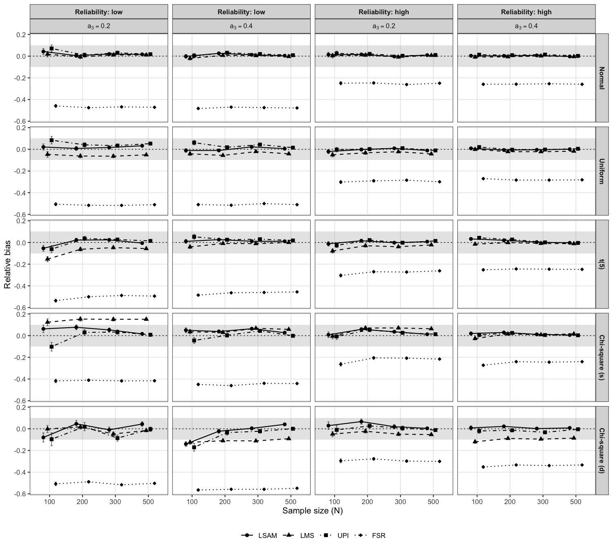
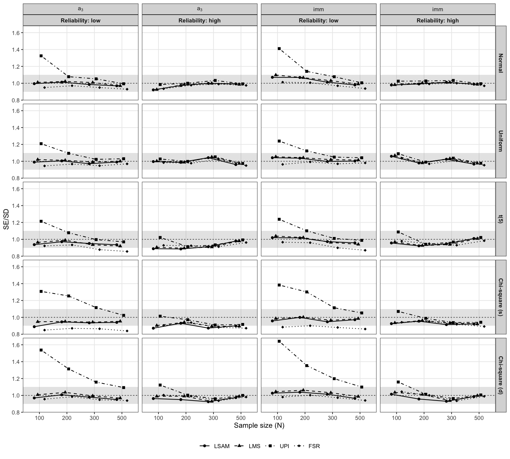
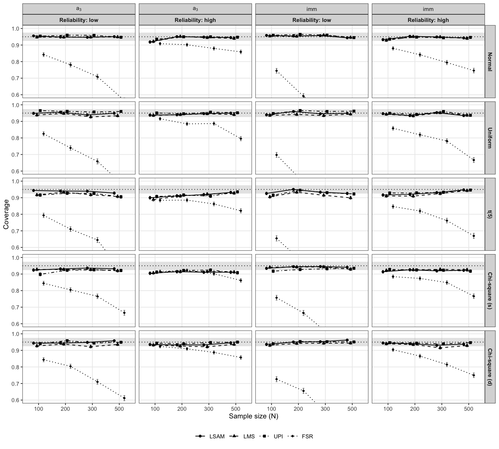
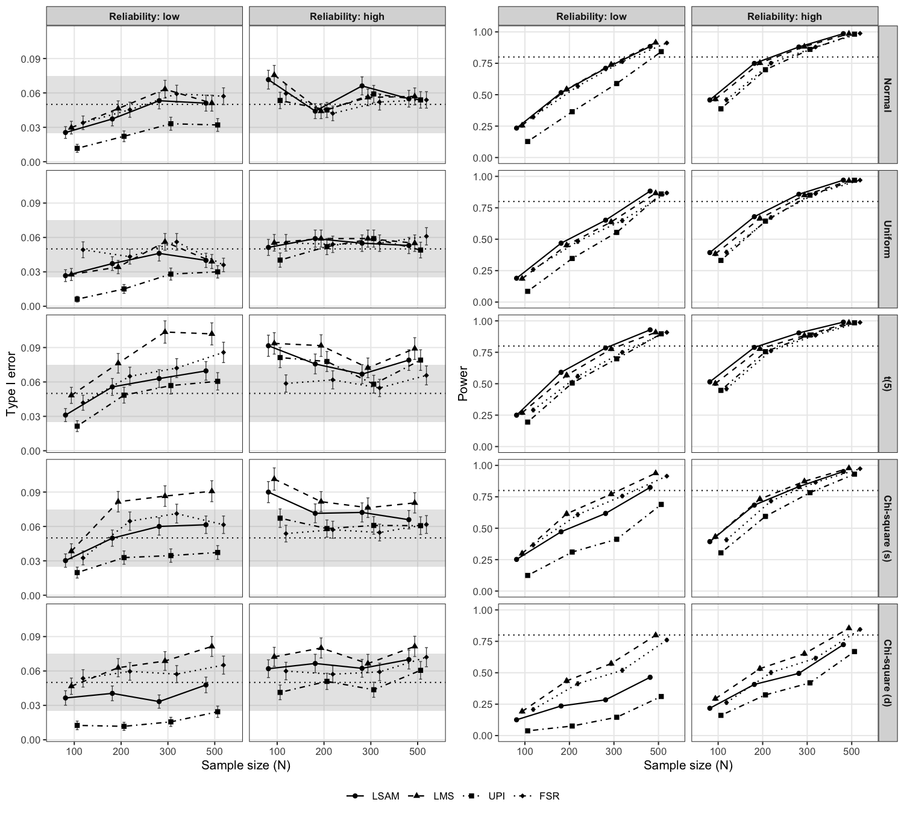
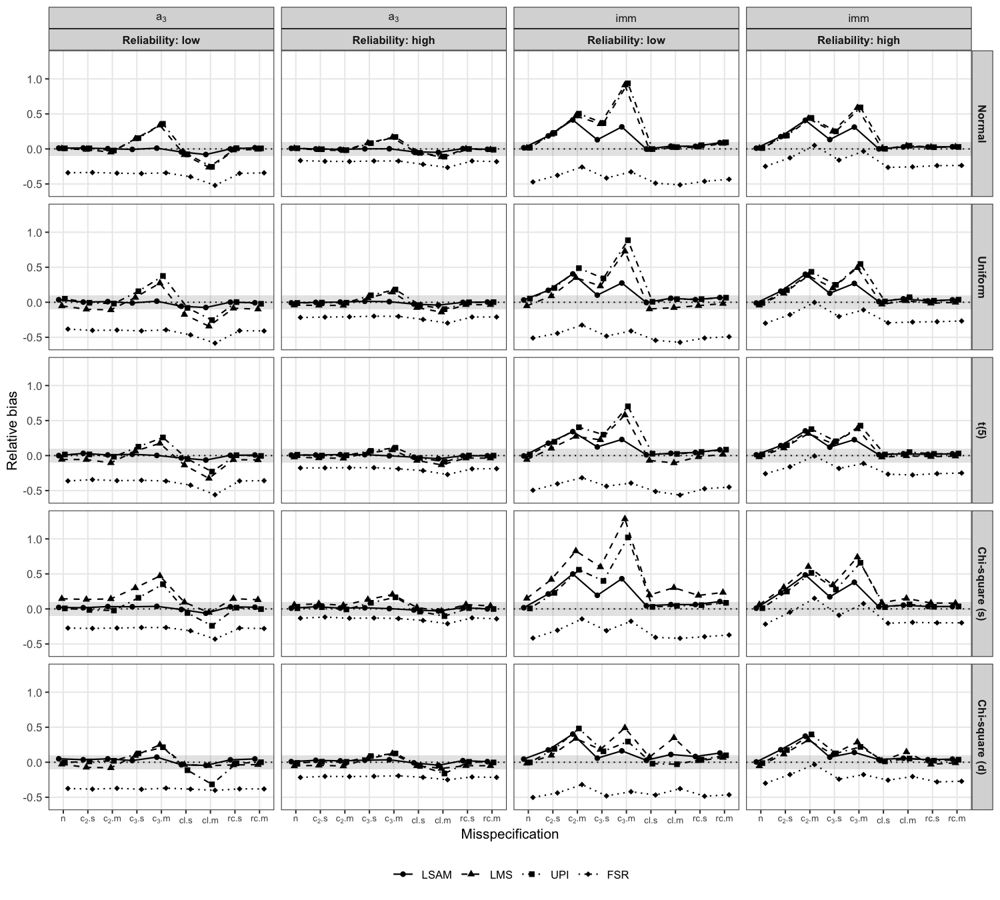
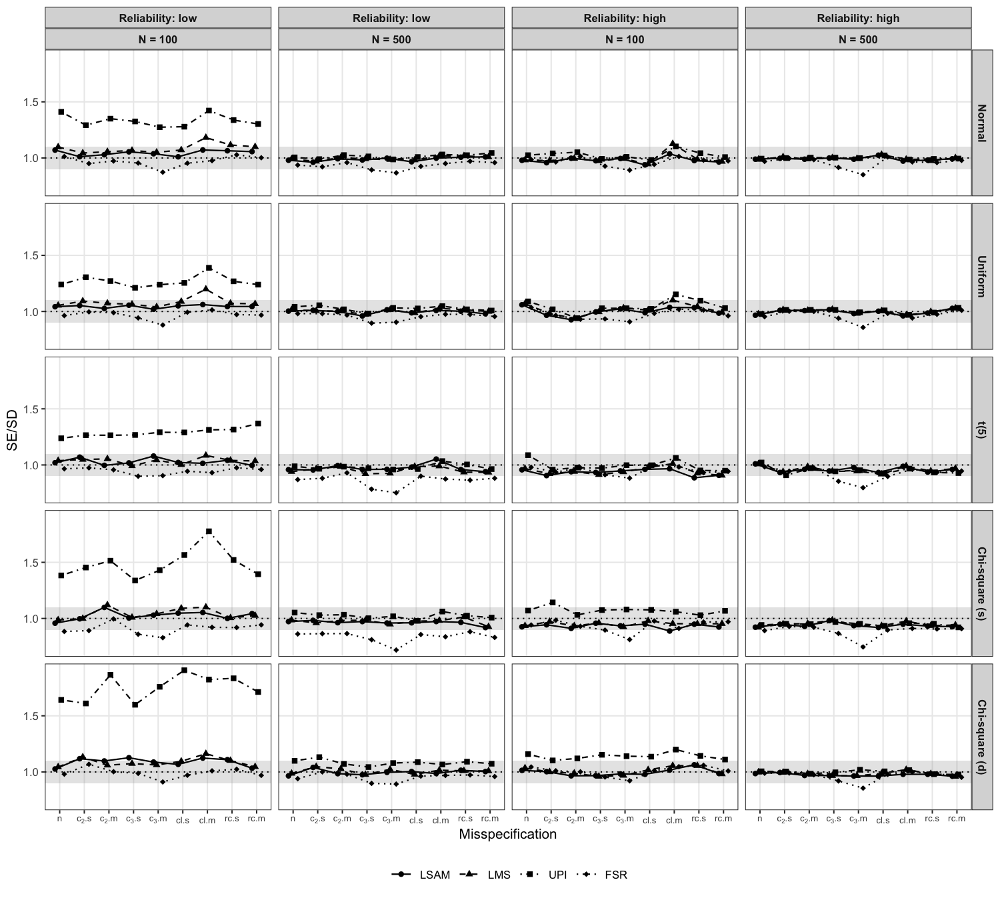
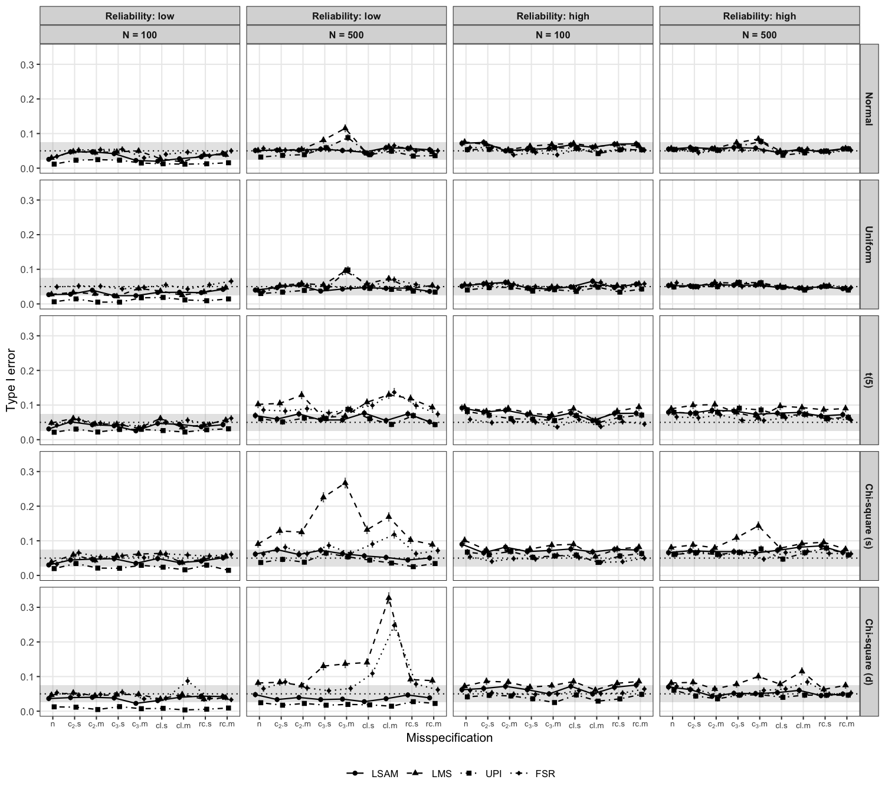
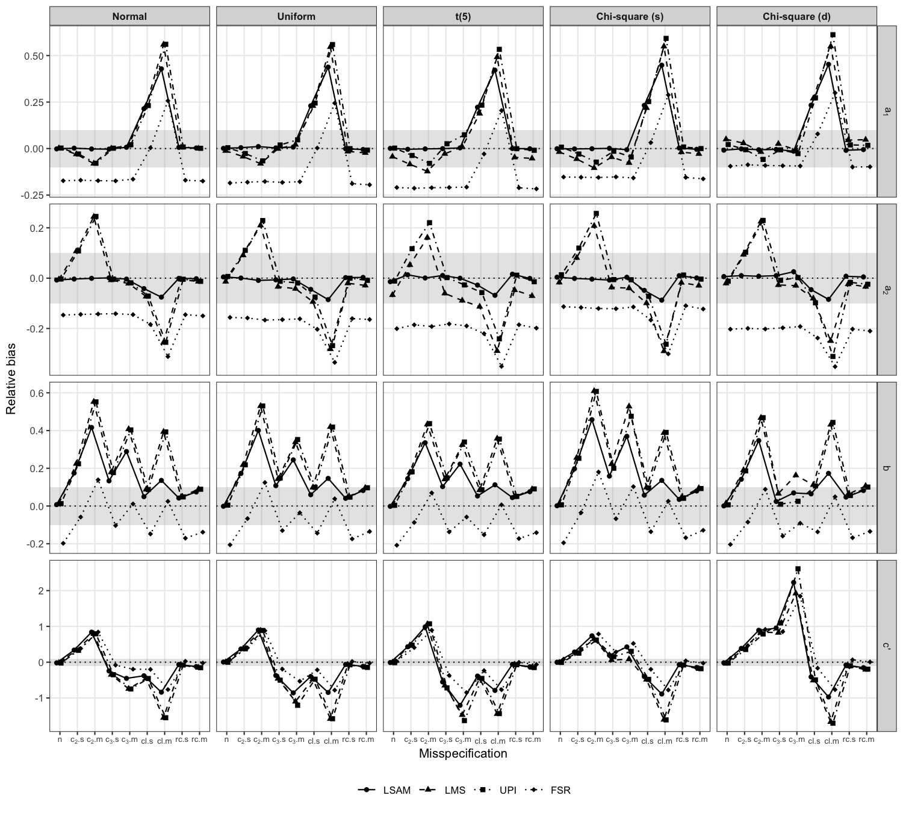
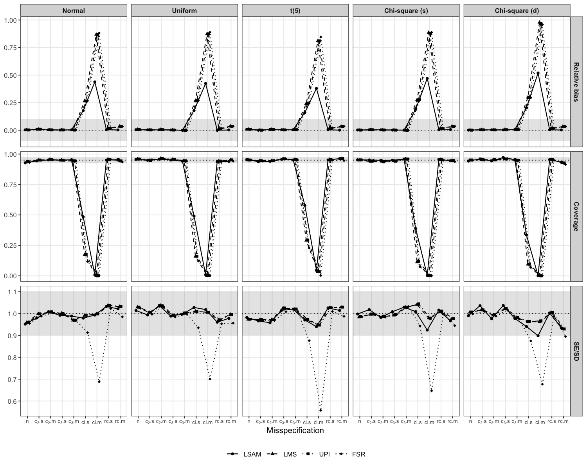

Mediation analysis is a well-known procedure in the behavioral and social
sciences [@Hayes2018; @Preacher2007; @Pieters2017; @Charlton2021]. In its 
basic and standard form, the effect of an independent variable on an outcome is 
decomposed into a direct effect and an indirect effect transmitted through a 
mediator, with all variables observed. This single mediator model has
been extended in a number of directions, most relevant here being the
case in which the indirect effect is allowed to depend on a moderator
[@Hayes2015; @Edwards2007; @Preacher2007; @Montoya2024; 
@MacKinnonFairchild2007].

In this context, a fundamental concern may arise from measurement. Many
constructs under investigation are not directly observed but are measured
indirectly through multiple items, that is, they are latent variables
[@BollenHoyle2012]. When such constructs are reduced to summary scores (e.g., a
sum or mean of the items) and analyzed as though they were observed, a
restrictive measurement structure is imposed rather than tested
[@McNeishWolf2020] and measurement error is left unmodeled. This error can
attenuate or inflate the indirect effect and distort inferences about it
[@ColePreacher2014; @HoyleKenny1999], and it is especially consequential for the
mediator, which acts at once as a predictor and an outcome
[@GonzalezMacKinnon2021]. The problem is compounded under moderation, where the
product term is even less reliable than either of its constituents
[@Bohrnstedt1978; @Busemeyer1983]. To address this, structural equation modeling
(SEM) with latent variables has been advocated, especially in the context of
mediation [@CheungLau2008; @FalkBiesanz2015; @LedgerwoodShrout2011;
@Montoya2024]. With a correctly specified measurement model, SEM estimates
structural paths among latent factors while accounting for indicator-specific
residual variance [@Bollen1989; @DeShon1998; @Rhemtulla2020]. Yet we also note
that latent variables do not necessarily improve power in general, whether for
interactions or not [@Cham2012; @LedgerwoodShrout2011; @WangRhemtulla2021].

Moderated mediation with latent variables is not straightforward in terms of
statistical estimation. Indeed, a latent interaction^[We use interaction and
moderation interchangeably, as the focus is on estimation, but we highlight that
they imply different interpretations and causal assumptions [@VanderWeele2009].
An interaction also need not be a product term, although that is the most common
functional form used by researchers [@Rimpler2026].] involves the product of two
latent variables, which is unobserved and nonnormal even when its constituents
are normal [@KelavaBrandt2022]. Following this, a number of methods have been
proposed to estimate nonlinear effects among latent variables [e.g., @Boker2023;
@Bollen1995; @KennyJudd1984; @KleinMoosbrugger2000; @KleinMuthen2007;
@Marsh2004; @MooijaartBentler2010]. Most adopt a joint ("system-wide")
estimation strategy, in which the measurement and structural parameters are
estimated simultaneously. This is the case of the two best-known methods, latent
moderated structural equations (LMS) and the unconstrained product indicator
(UPI) approach. In contrast, structural-after-measurement (SAM) approaches
[@CoxKelcey2021; @HolstBudtz2020; @NgChan2020; @Rosseel2025; @WallAmemiya2000;
@WallAmemiya2003] estimate the measurement model first and the structural model
afterward, with the measurement parameters held fixed. Many of these approaches
have so far rarely been applied in practice, likely held back by limited
software, slow estimation, and error-prone implementations. With recent
open-source implementations [@HolstBudtz2020; @Rosseel2025; @Slupphaug2025] and
non-commercial software [@Keller2025], this is likely to change.

Beyond estimation, a further consideration concerns interpretation. Mediation is
a hypothesis about causal effects, and causal interpretation requires
identification assumptions that *may* not be verified from the data alone [e.g.,
@Imai2010; @Rohrer2022]. With latent variable models, further caution is needed
[@Morelli2026; @Sterner2024; @VanderWeeleVansteelandt2022]. We focus on one that
is central to interpretation: the estimated latent variables must validly
represent the intended constructs [@GonzalezMacKinnon2021]. In fact, when they
do not, the model is subject to interpretational confounding [@Burt1976], a
discrepancy between the empirical meaning assigned to a latent variable through
its estimated measurement parameters and the meaning intended by the researcher.
This reflects an underlying property of system-wide estimation, namely that the
consequences of a misspecification are not confined to the part of the model in
which it occurs [@BainterBollen2014; @Bollen2007; @Kaplan1988]. @Burt1976
proposed estimating the measurement model first in order to separate the
estimated latent variables and their empirical meaning from the structural model
that follows. SAM approaches follow this strategy [e.g., @RosseelLoh2024],
although it does not imply that the structure is correct
[@VanderWeeleVansteelandt2022].

Despite the relevance of misspecification, prior simulation work has examined
latent interaction estimation mainly under distributional misspecification
[e.g., @Cham2012; @Vieira2026;
@Lonati2025; @Brandt2014], and in only two cases under misspecification at the 
measurement level [@Brandt2020; @NavarroSchermelleh2025]. Among the
approaches studied here, these considered only UPI and LMS, and in limited
settings. Moreover, when it comes to (moderated) mediation, despite its 
popularity in applied research, only a few studies have investigated it with 
latent variables, and those assumed a correctly specified (and saturated) model 
[@CheungLau2017; @FalkBiesanz2015; @Feng2020]. In this article, we therefore 
evaluate four estimation approaches for a latent variable moderated mediation
model: local SAM [LSAM\; @Rosseel2025], LMS [@KleinMoosbrugger2000;
@Kelava2011], UPI [@KelavaBrandt2009; @Marsh2004], and, as a baseline,
factor score regression (FSR).
The first three have been explained extensively in previous
research and we refer readers to it [e.g., @Brandt2020; @Vieira2026; 
@Lonati2025; @Rosseel2025; @Kelava2011; @Lin2010; @Slupphaug2025].

### Present Research and Contributions

This study makes two contributions. First, we evaluate LSAM alongside LMS 
and UPI under both measurement and structural misspecification, in a 
considerably broader design than previous studies, detailed in the 
next section. The robustness of LSAM to model misspecification has itself 
been examined only in linear models [@RosseelLoh2024], with later research 
disputing it for measurement misspecifications and expecting it to hold 
mainly for structural misspecifications in non-saturated structural models 
[@Robitzsch2022], a case not yet tested for models with nonlinear effects. 
Second, we obtain inference for the index of moderated mediation 
[imm\; @Hayes2015], a nonlinear function of the structural parameters, with 
the Monte Carlo method [@MacKinnonLockwood2004; @PreacherSelig2012].
The latent variable studies above used the bootstrap
[@CheungLau2017; @Feng2020]. Bootstrapping is computationally expensive, and
its variants differ modestly in performance and rank differently depending
on the criterion [@FalkBiesanz2015; @Tibbe2022], whereas the Monte Carlo
method needs only the estimates and their covariance matrix. Whether it
meets the usual criteria for coverage and standard error accuracy for the
imm in the context under investigation has not been examined, and is the
question we address here. We do not compare it with the bootstrap.

```{r}
#| include: false
# smoke-test for the knitr engine. add library() calls and data reads
# (e.g. readRDS("../results/summary.rds")) — plus the matching packages in
# gen_env.R's r_pkgs — as the manuscript needs them.
invisible(1 + 1)
```

# Simulation Design and Performance Evaluation

In this section we describe the design of the simulation study and the
measures used to evaluate performance, following the preregistration and some 
recent recommendations for the conduct and reporting of simulation studies 
[@Siepe2024; @Pawel2026].

### Population Models and Estimands

We study a moderated mediation model among four latent variables: an
exogenous predictor $X$, a moderator $W$, a mediator $M$, and an outcome $Y$.
The structural model that is fitted in every condition, and that is the
population model in the correctly specified condition, is

$$
M = a_1 X + a_2 W + a_3\,(X \times W) + \zeta_M, \qquad
Y = b\,M + c'\,X + \zeta_Y.
$$

\noindent In the misspecified conditions the
population departs from it by one additional element, which the fitted model
omits. @fig-model shows the population model, where the measurement and
structural misspecifications studied below are drawn in gray.

The primary estimands are the interaction coefficient ($a_3$) and the imm (i.e.,
$a_3 b$). The remaining structural coefficients ($a_1$, $a_2$, $b$, $c'$) and
the twelve freely estimated factor loadings serve as secondary estimands. Note
the imm is a derived quantity rather than a free parameter, hence its true value
is computed as $a_3 b$ implied by the correctly specified model.

Population values were fixed at $a_1 = 0.4$, $a_2 = 0.3$, $b = 0.5$, and
$c' = 0.15$, with $\operatorname{Cor}(X, W) = 0.3$. The interaction coefficient
$a_3$ is a design factor (see below). These coefficients, together with the
structural disturbance variances, were chosen so that under the baseline
condition (normal exogenous predictors and a correctly specified model) each
dependent latent variable has $R^2 \approx 0.30$ at the interaction level
$a_3 = 0.20$. Also note that, because $a_3$ contributes to the variance of $M$,
the explained variance is naturally higher with a larger $a_3$ and lower when
its effect is null. The realized values are reported in the supplementary
materials. Each latent variable is measured by four congeneric indicators with
loadings $1.0$, $0.8$, $0.7$, and $0.6$.

```{tikz}
%| label: fig-model
%| fig-cap: "Population Model for the Simulation Study."
%| apa-note: "$X$, $W$, $M$, and $Y$ are latent variables, each measured by four congeneric indicators. Circles are latent variables and $X{\\times}W$ is the latent interaction. Black elements form the correctly specified model that every approach fits ($a_1$, $a_2$, $a_3$, $b$, $c'$, and the $X$--$W$ covariance). Gray elements are the misspecifications present in the population but omitted from the fitted model: two in the structural part, an omitted moderator effect on the outcome ($c_2$) and an omitted moderated direct effect ($c_3$); and two in the measurement part, an omitted cross-loading of $m_3$ on $X$ (cl) and an omitted residual covariance between $m_3$ and $y_3$ (rc). Residual variances and intercepts are not shown."
%| fig-align: center
%| fig-width: 9
%| fig-height: 6

\tikzset{
  latent/.style  ={circle,draw,minimum size=12mm},
  ind/.style     ={rectangle,draw,minimum height=6mm,minimum width=7mm,align=center},
  derived/.style ={circle,draw,minimum size=12mm},
  mis/.style     ={->,gray!70,thick,dashed},
  miscov/.style  ={<->,gray!70,thick,dashed},
  every node/.style={font=\small}
}

\begin{tikzpicture}

% X
\node[ind] (x1) at (0,  5.4) {$x_1$};
\node[ind] (x2) at (0,  4.6) {$x_2$};
\node[ind] (x3) at (0,  3.8) {$x_3$};
\node[ind] (x4) at (0,  3.0) {$x_4$};
\node[latent] (X) at (2.6, 4.2) {$X$};
\draw[->] (X.west) -- (x1.east);
\draw[->] (X.west) -- (x2.east);
\draw[->] (X.west) -- (x3.east);
\draw[->] (X.west) -- (x4.east);

% moderator W
\node[ind] (w1) at (0,  1.4) {$w_1$};
\node[ind] (w2) at (0,  0.6) {$w_2$};
\node[ind] (w3) at (0, -0.2) {$w_3$};
\node[ind] (w4) at (0, -1.0) {$w_4$};
\node[latent] (W) at (2.6, 0.2) {$W$};
\draw[->] (W.west) -- (w1.east);
\draw[->] (W.west) -- (w2.east);
\draw[->] (W.west) -- (w3.east);
\draw[->] (W.west) -- (w4.east);

% interaction
\node[derived] (XW) at (2.6, -3.2) {$X{\times}W$};

% X-W covariance (part of the fitted model)
\draw[<->] (X) to[bend right=42] (W);

% m
\node[latent] (M) at (7.0, 2.2) {$M$};
\node[ind] (m1) at (5.5, 5.2) {$m_1$};
\node[ind] (m2) at (6.5, 5.2) {$m_2$};
\node[ind] (m3) at (7.5, 5.2) {$m_3$};
\node[ind] (m4) at (8.5, 5.2) {$m_4$};
\draw[->] (M.north) -- (m1.south);
\draw[->] (M.north) -- (m2.south);
\draw[->] (M.north) -- (m3.south);
\draw[->] (M.north) -- (m4.south);

% outcome y
\node[latent] (Y) at (11.4, 2.2) {$Y$};
\node[ind] (y1) at (13.8, 3.4) {$y_1$};
\node[ind] (y2) at (13.8, 2.6) {$y_2$};
\node[ind] (y3) at (13.8, 1.8) {$y_3$};
\node[ind] (y4) at (13.8, 1.0) {$y_4$};
\draw[->] (Y.east) -- (y1.west);
\draw[->] (Y.east) -- (y2.west);
\draw[->] (Y.east) -- (y3.west);
\draw[->] (Y.east) -- (y4.west);

% correct struct paths
\draw[->] (X)  -- node[above,sloped,font=\footnotesize] {$a_1$} (M);
\draw[->] (W)  -- node[below,sloped,font=\footnotesize] {$a_2$} (M);
\draw[->] (XW) -- node[below,sloped,font=\footnotesize] {$a_3$} (M);
\draw[->] (M)  -- node[above,font=\footnotesize] {$b$} (Y);
\draw[->] (X)  to[bend left=22] node[above,font=\footnotesize] {$c'$} (Y);

% misspecifications (gray): c2/c3 structural, cl/rc measurement
\draw[mis] (W)  to[bend right=24] node[below,sloped,font=\footnotesize,text=gray] {$c_2$} (Y);
\draw[mis] (XW) to[bend right=34] node[below,sloped,font=\footnotesize,text=gray] {$c_3$} (Y);
\draw[mis] (X) to[out=68,in=128] node[above,font=\footnotesize,text=gray,pos=0.62] {cl} (m3.north);
\draw[miscov] (m3.north) to[out=42,in=150] node[above,sloped,font=\footnotesize,text=gray,pos=0.5] {rc} (y3.north west);

\end{tikzpicture}
```

### Simulation Conditions

We employed a fully factorial design crossing five factors: sample size
($N \in \{100, 200, 300, 500\}$), interaction magnitude
($a_3 \in \{0, 0.20, 0.40\}$), measurement reliability (low $= 0.5$,
high $= 0.7$), the distribution of the exogenous latent predictors (normal, 
uniform, $t_5$, and two $\chi^2$ conditions with same- or opposite-direction 
skewness), and the (mis)specification conditions (nine cases; see
Data Generation below). This yielded 
$4 \times 3 \times 2 \times 5 \times 9 = 1{,}080$ 
conditions, each replicated 1,000 times.

Sample sizes cover the small to moderate range, where interaction terms are
estimated with limited power [@Brandt2020; @Lonati2025]. The interaction
magnitudes include a null condition to assess Type I error for the interaction
coefficient and imm, and two nonzero levels representing small and moderate
latent moderation effects, following previous research [@Feng2020;
@KleinMoosbrugger2000]. Reliability levels of $0.5$ and $0.7$ were chosen
because measurement error is amplified in product terms and is therefore
especially consequential for latent interaction estimation [@Lonati2025;
@Vieira2026; @Brandt2020]. Nonnormality of the latent predictors is both
empirically common and methodologically central for latent interaction
approaches, whose distributional assumptions differ across approaches
[@KleinMoosbrugger2000; @KleinMuthen2007; @Cham2012; @Lonati2025; @Vieira2026].
The misspecification conditions follow the moderated mediation framework for the
two structural omissions [@Preacher2007] and prior latent interaction simulation
work for the two measurement omissions [@Brandt2020]. They were also chosen as
interpretable violations, acting respectively as a measured mediator–outcome
confounder [@Imai2010], a conflated moderated direct effect [@Edwards2007],
exposure-correlated measurement error in the mediator [@VanderWeeleValeri2012;
@Fritz2016], and a shared unmeasured cause of a mediator and an outcome
indicator [@Cole2007]. The misspecification cases are detailed below.

### Estimation Approaches

We used LSAM [@RosseelLoh2024; @Rosseel2025; @Vieira2026], with the 
measurement model estimated by maximum likelihood (ML) in the first step and 
with standard errors obtained as in @Vieira2026 (see their Appendix A). In 
this case, the
interacting predictors $X$ and $W$ shared a single measurement block,
while $M$ and $Y$ formed their own blocks. We further used LMS 
[@KleinMoosbrugger2000] and the extended UPI approach with double mean 
centering [@KelavaBrandt2009; @Marsh2004; @Lin2010], the latter estimated by 
ML. For both, robust standard errors were obtained with the Huber–White 
sandwich estimator.
As a baseline, we also used FSR^[We note that the
approach of @SkrondalLaake2001, used for latent interactions by @NgChan2020, 
would be a more principled choice, in which regression (Thurstone) factor 
scores are used for the explanatory variables and Bartlett factor scores for 
the response variables. However, as noted previously [@Devlieger2016], this 
does not work in models where a variable is both explanatory and a response, 
as the mediator is here.]. Specifically, Bartlett factor scores were computed 
from a confirmatory factor model of the four latent variables estimated by 
ML, and the structural model was estimated on the scores by ML, which gives 
the ordinary least squares estimates, with standard errors solely from this
second step.

### Data Generation

The supplementary materials describe the complete data generating mechanism and
its calibration in detail. Briefly, the latent variables $X$ and $W$ were drawn
from a bivariate distribution with $\operatorname{Cor}(X, W) = \rho = 0.3$,
constructed with the vine-to-anything (VITA) algorithm [@Gronneberg2022]. Five
exogenous distributions were examined, each standardized to mean $0$ and
variance $1$. The normal condition draws $X, W \sim \mathcal{N}(0, 1)$ through a
Gaussian copula, whereas the remaining four combine nonnormal margins with the
Clayton copula: uniform, $t_5$, and two $\chi^2(2)$ conditions in which $X$ and
$W$ are skewed in the same or in opposite directions. The nonnormal conditions
therefore differ from the normal condition in the dependence between the
predictors as well as in their margins. As a sensitivity analysis, they were
repeated with a Gaussian copula to separate the two (see the supplementary
materials). For each distribution, the bivariate population was constructed once
and every replication was sampled from it. Then, $M$ and $Y$ were generated from
the structural equations above with independent Gaussian disturbances
$\zeta_M \sim \mathcal{N}(0, \psi_M)$ and $\zeta_Y \sim \mathcal{N}(0, \psi_Y)$,
and the four indicators ($j = 1, \dots, 4$) of each latent variable
$\eta \in \{X, W, M, Y\}$ were formed as
$z_{\eta j} = \lambda_j \eta + \delta_{\eta j}$, with loadings
$\lambda = (1, 0.8, 0.7, 0.6)$ and Gaussian errors
$\delta_{\eta j} \sim \mathcal{N}(0, \theta_{\eta j})$ whose variances
$\theta_{\eta j}$ were set to give the target reliability
$\omega \in \{0.5, 0.7\}$ under normal predictors and held fixed across
distributions.

The nine (mis)specification conditions comprise one correctly specified
condition and four types of misspecification, each at two calibrated magnitudes
(standardized $0.25$ and $0.50$), similar to @Brandt2020. The two structural
ones are an omitted direct effect of the moderator on the outcome ($c_2$) and an
omitted moderated direct effect ($c_3$). The two in the measurement model are a
cross-loading of a mediator indicator on $X$ (`cl`) and a residual covariance
between a mediator and an outcome indicator (`rc`). In every case the effect is
present in the population but omitted from the estimated model.

### Convergence, Outliers, and Inadmissible Solutions

Following previous research [@Lonati2025; @Vieira2026], replications were
screened in two sequential steps, and a replication that failed either step for
any estimation approach was removed for all of them, so that every approach is
compared on the same replications. First, a solution was treated as nonconverged
when the optimizer reported nonconvergence or when any estimate, standard error,
or confidence interval bound was missing or non-finite. Second, among the
remaining replications, outliers were identified per condition and approach as
estimates of the imm or a structural coefficient more than three interquartile
ranges beyond the quartiles, or with a standard error above $10$^[The standard
error criterion additionally removed 113 replications (about $0.01\%$), almost
all for UPI and mostly at the smallest sample size with low reliability.]. We
also recorded, without removing them, inadmissible solutions, in which a
residual variance was nonpositive or the covariance matrix of the latent
variables and disturbances was not positive definite. The same was done for
converged solutions whose information matrix was not positive definite. Their
frequencies and the sensitivity of the results to the outlier screening are
reported in the supplementary materials.

### Performance Measures

Performance was assessed with the measures implemented in the *simhelpers*
package [@Joshi2025], computed for the imm, the structural coefficients, and the
loadings. These measures, with their empirical and Monte Carlo standard error 
(MCSE) calculations, are listed in @tbl-performance. Note that the MCSEs 
are obtained in closed form where available and by jackknife otherwise. 
In addition, where applicable, we report the rejection rate 
(Type I error when $a_3 = 0$, power otherwise).

```{r}
#| label: tbl-performance
#| tbl-cap: "Subset of the Performance Measures for Evaluating Parameter Estimates"
#| apa-note: "$\\hat\\theta_k$ is the estimate of parameter $\\theta$ in replication $k$ ($k = 1, \\dots, K$ usable replications), $\\bar{\\hat\\theta}$ its mean, $S_{\\hat\\theta}^2$ its sample variance, and $S_{\\hat\\theta}$ its standard deviation (SD); the root mean square error is $\\mathrm{RMSE} = \\sqrt{\\tfrac{1}{K}\\sum_k (\\hat\\theta_k-\\theta)^2}$; $\\widehat{SE}_k$ is the estimated standard error (SE), $\\overline{SE^2} = \\tfrac{1}{K}\\sum_k \\widehat{SE}_k^2$, and $L_k, U_k$ the confidence-interval limits; $c$ and $r$ denote coverage and rejection rate, and $\\nu$ the SE$^2$/VAR ratio. The subscript $(j)$ marks a leave-one-out jackknife replicate. The MCSEs for relative RMSE and the SE$^2$/VAR ratio are computed by jackknife; the others are closed-form, and dashes mark MCSEs that are not computed."
g <- function(x) paste0("\\textit{", x, "}")
tab <- data.frame(
  measure = c(
    g("Relative criteria"),
    "Relative bias", "Relative RMSE",
    g("Standard errors"),
    "Mean SE", "SE/SD ratio", "SE$^2$/VAR ratio",
    g("Coverage"),
    "Coverage",
    g("Hypothesis testing"),
    "Rejection rate"),
  empirical = c(
    "",
    "$\\tfrac{\\bar{\\hat\\theta}}{\\theta}-1$",
    "$\\tfrac{1}{|\\theta|}\\sqrt{\\tfrac{1}{K}\\sum_{k=1}^{K}(\\hat\\theta_k-\\theta)^2}$",
    "",
    "$\\overline{SE}=\\tfrac{1}{K}\\sum_{k=1}^{K}\\widehat{SE}_k$",
    "$\\overline{SE}/S_{\\hat\\theta}$",
    "$\\nu=\\overline{SE^2}/S_{\\hat\\theta}^2$",
    "",
    "$c=\\tfrac{1}{K}\\sum_{k=1}^{K}I(L_k\\le\\theta\\le U_k)$",
    "",
    "$r=\\tfrac{1}{K}\\sum_{k=1}^{K}I(0\\notin[L_k,U_k])$"),
  mcse = c(
    "",
    "$\\sqrt{S_{\\hat\\theta}^2/(K\\theta^2)}$",
    "$\\tfrac{1}{|\\theta|}\\sqrt{\\tfrac{K-1}{K}\\sum_{j=1}^{K}(\\mathrm{RMSE}_{(j)}-\\mathrm{RMSE})^2}$",
    "",
    "---", "---",
    "$\\sqrt{\\tfrac{K-1}{K}\\sum_{j=1}^{K}(\\nu_{(j)}-\\nu)^2}$",
    "",
    "$\\sqrt{c(1-c)/K}$",
    "",
    "$\\sqrt{r(1-r)/K}$"))
knitr::asis_output(paste0("\\begin{center}\n",
  knitr::kable(tab, booktabs = TRUE, escape = FALSE, longtable = TRUE,
               linesep = "", format = "latex",
               col.names = c("Performance measure", "Empirical calculation", "MCSE")),
  "\n\\end{center}"))
```

Inference for the imm followed the Monte Carlo method as mentioned before: 
for $d = 1, \dots, D$ (with $D = 20{,}000$) we drew

$$
\bigl(a_3^{(d)}, b^{(d)}\bigr) \sim
\mathcal{N}_2\!\bigl((\hat a_3, \hat b),\, \hat\Sigma_{a_3 b}\bigr),
\qquad
\mathrm{imm}^{(d)} = a_3^{(d)}\, b^{(d)},
$$

\noindent where $\hat\Sigma_{a_3 b}$ is the estimated covariance of
$(\hat a_3, \hat b)$, and took the $2.5$th and $97.5$th empirical percentiles of
$\{\mathrm{imm}^{(d)}\}_{d=1}^{D}$ as the interval. The structural coefficients
and loadings use Wald-based intervals from the same estimated covariance matrix
of the parameter estimates.

### Reproducibility and Computational Details

All analyses were conducted in R [@RCoreTeam] using the *lavaan* [@Rosseel2012]
and *modsem* [@Slupphaug2025] packages for estimation, *covsim*
[@Gronneberg2022] and *rvinecopulib* [@Nagler2025] for data generation, and
*simhelpers* [@Joshi2025] for performance evaluation. For data and figure
processing, we used *dplyr* [@Wickham2026], *tidyr* [@Wickham2025], and
*ggplot2* [@Wickham2016]. Conditions were run in parallel with the *parallel*
package [@RCoreTeam]. Reproducible and independent random-number streams were
obtained with the L'Ecuyer-CMRG generator. The computational environment was
pinned with Nix [@dolstra_etall_2004] via the *rix* package [@rix] to ensure
reproducibility, and the article was written with the *apaquarto* extension
[@apaquarto]. For the R version, package versions, code, manuscript, and
materials, see the project repository.

# Results

We present the results in four parts. After the convergence results, we report
the interaction coefficient and the imm, first under correct structural and
measurement specification and then under misspecification. We then turn to the
remaining structural coefficients (i.e., $a_1$, $a_2$, $b$, and $c'$), and we
close with the estimated factor loadings, focusing mainly on that of the
cross-loaded indicator ($m_3$). Due to the large number of conditions, the
figures in the main text show a subset. Complete results, and detailed
convergence and outlier information, are available in the supplementary
materials.

## Convergence, Outliers, and Inadmissible Solutions

LSAM and FSR converged in every replication of every condition. UPI and LMS
converged in at least 98% of replications in most conditions, with lowest rates
of 93% for UPI ($N = 100$, low reliability, $\chi^2$ predictors) and 89% for LMS
($N = 500$, high reliability, $t_5$ predictors). Outliers were below 1% in most
conditions and reached at most 3% for LSAM, LMS, and FSR and 11% for UPI
($N = 100$, low reliability, $\chi^2$ predictors). Inadmissible solutions arose
almost exclusively for UPI, mainly at $N = 100$ with low reliability. They were
retained, and excluding them changes the results primarily for UPI in these
conditions. Details are in Tables 3 and 4 of the supplementary materials.

## Correct Structural and Measurement Specification

We show the imm for every measure, and the interaction coefficient alongside 
it where the two differ, that is, for the standard errors and coverage. 
Relative bias is shown at both nonzero interaction magnitudes ($a_3 = 0.2$ and 
$0.4$), the standard errors, coverage, and power at the smaller one, and the 
Type I error under no interaction ($a_3 = 0$). 

### Relative Bias and Relative RMSE

An absolute relative bias of at most 0.10 (10%) was considered acceptable,
following previous research [@Brandt2014; @Vieira2026]. LSAM and UPI recover
the imm with acceptable bias in nearly all conditions
(@fig-baseline-bias-imm). Their bias exceeds the acceptable range only at
$N = 100$ with low reliability and $\chi^2$ predictors, where it reaches
$-0.11$ for LSAM and $-0.18$ for UPI. With normal, uniform, and $t_5$
predictors, the bias of LMS is acceptable as well, with one exception at
$N = 100$ ($-0.16$). With $\chi^2$ predictors, however, its bias persists
across sample sizes, reaching 0.15 under same skewness ($a_3 = 0.2$, low
reliability) and about $-0.10$ under opposite skewness ($a_3 = 0.4$). FSR
underestimates the imm in every condition, by 21% to 35% at high reliability
and by 41% to 56% at low reliability, irrespective of sample size. The
interaction coefficient shows the same pattern (see Figure 3 of the
supplementary materials). Among LSAM, LMS, and UPI, the relative RMSE is
lowest for LMS and highest for UPI in nearly every condition. That of LSAM is
close to that of LMS (on average about 6% higher), except with
opposite-skewness $\chi^2$ predictors, where it is about 1.4 times as large
(see Figures 12 to 15 of the supplementary materials).

```{r}
#| label: fig-baseline-bias-imm
#| fig-cap: "Relative Bias of the imm ($a_3 b$) Under Correct Structural and Measurement Specification"
#| apa-note: "The gray band marks the acceptable region for the measure, and the error bars represent the Monte Carlo standard error (MCSE). imm = index of moderated mediation; LSAM = local structural-after-measurement; LMS = latent moderated structural equations; UPI = unconstrained product indicator; FSR = factor score regression."
#| out-width: "100%"

```

### Standard Errors

SE/SD ratios between 0.90 and 1.10 were considered acceptable [@Brandt2014;
@Vieira2026]. For the imm, whose standard error is based on the Monte Carlo
method, the ratio is acceptable for LSAM and LMS in every condition
(@fig-sesd). UPI overestimates the standard error in 13 conditions, all but
one at low reliability and none at $N = 500$, with ratios as high as 1.64.
Much of this overestimation is due to a small number of extreme standard
errors, without which the ratio is acceptable in 9 of these 13 conditions
(see Table 5 of the supplementary materials). FSR slightly underestimates the
standard error in a few conditions (0.86 at the lowest). For the interaction
coefficient the ratios are slightly lower than for the imm, so that LSAM and
LMS also fall just below 0.90 in a few conditions (0.87 at the lowest). With
the SE$^2$/VAR ratio, UPI remains the highest and FSR the lowest, but LSAM and
LMS also exceed 1.10 at $N = 200$ with low reliability (see Figures 39 and 40
of the supplementary materials). The results at the larger interaction
magnitude are also reported ($a_3 = 0.4$; see Figures 18, 19, 22, and 23 of
the supplementary materials).

```{r}
#| label: fig-sesd
#| fig-cap: "SE/SD of the Interaction Coefficient ($a_3$) and the imm ($a_3 b$) Under Correct Structural and Measurement Specification at $a_3 = 0.2$"
#| apa-note: "The gray band marks the acceptable region for the measure. imm = index of moderated mediation; LSAM = local structural-after-measurement; LMS = latent moderated structural equations; UPI = unconstrained product indicator; FSR = factor score regression."
#| out-width: "100%"

```

### Coverage

Coverage between 92.5% and 97.5% was considered acceptable. For the imm, the
coverage of LSAM, LMS, and UPI is acceptable in most conditions
(@fig-coverage). It falls slightly below the range in 5 to 7 of the 40
conditions per approach, nearly all with $t_5$ and same-skewness $\chi^2$
predictors, to 0.91 for LSAM and UPI and 0.90 for LMS at the lowest. The
coverage of the interaction coefficient is slightly lower and falls below the
range more often (0.89 at the lowest). For FSR, coverage decreases with
sample size, because the interval narrows around a biased estimate, to as low
as 0.16 for the imm at $N = 500$ with low reliability. At the larger
interaction magnitude ($a_3 = 0.4$), the coverage of the imm falls below the
range more often for UPI (0.88 at the lowest) and for LMS with
opposite-skewness $\chi^2$ predictors (see Figures 26, 27, 30, and 31 of the
supplementary materials).

```{r}
#| label: fig-coverage
#| fig-cap: "Coverage of the Interaction Coefficient ($a_3$) and the imm ($a_3 b$) Under Correct Structural and Measurement Specification at $a_3 = 0.2$"
#| apa-note: "The gray band marks the acceptable region for the measure, and the error bars represent the Monte Carlo standard error (MCSE). The vertical axis is truncated at 0.60, and lower values for FSR are not shown. imm = index of moderated mediation; LSAM = local structural-after-measurement; LMS = latent moderated structural equations; UPI = unconstrained product indicator; FSR = factor score regression."
#| out-width: "100%"

```

### Hypothesis Testing (Type I Error and Power)

Type I error rates between 2.5% and 7.5% were considered acceptable. At
$a_3 = 0$, LMS is liberal in 17 of the 40 conditions, nearly all with $t_5$
and $\chi^2$ predictors, with rates up to 0.10 (@fig-test). LSAM and UPI are
slightly liberal in a few conditions at high reliability (up to 0.09 and
0.08). At low reliability, UPI is instead conservative in 10 conditions (0.01
at the lowest), largely those in which its standard errors are overestimated.
FSR keeps the Type I error acceptable in all but one condition (0.09).

At $a_3 = 0.2$, power increases with sample size and reliability, and reaches
0.80 for most distributions only from $N = 300$ at high reliability and at
$N = 500$ at low reliability. LSAM and
LMS have similar power with normal, uniform, and $t_5$ predictors, whereas
with $\chi^2$ predictors LMS has higher power than LSAM and UPI. The
difference is largest with opposite-skewness $\chi^2$ predictors at low
reliability, where at $N = 500$ power is 0.80 for LMS, 0.46 for LSAM, and
0.31 for UPI. The higher power of LMS in this condition comes with a slightly
liberal Type I error (0.08), but its estimates are also more precise. Indeed,
with opposite-skewness $\chi^2$ predictors, the standard deviation of the
LSAM and UPI estimates is 1.3 to 1.9 times that of LMS. FSR has power close
to that of LMS. The interaction coefficient gives nearly identical results
(see Figures 32 to 35 of the supplementary materials).

```{r}
#| label: fig-test
#| fig-cap: "Type I Error ($a_3 = 0$) and Power ($a_3 = 0.2$) of the imm ($a_3 b$) Under Correct Structural and Measurement Specification"
#| apa-note: "The gray band marks the acceptable region for the Type I error, the dotted line in the power panels marks 0.80, and the error bars represent the Monte Carlo standard error (MCSE). imm = index of moderated mediation; LSAM = local structural-after-measurement; LMS = latent moderated structural equations; UPI = unconstrained product indicator; FSR = factor score regression."
#| out-width: "100%"

```

## Structural and Measurement Misspecification

Recall that the imm is the product of the interaction coefficient ($a_3$), from
the mediator equation, and $b$, from the outcome equation. The structural
omissions ($c_2$ and $c_3$) are in the outcome equation, to which $b$ belongs.
The measurement omissions (the cross-loading, `cl`, and the residual covariance,
`rc`) involve a mediator indicator, and the mediator enters both equations. We
show the relative bias of the interaction coefficient and the imm at $N = 500$,
because the bias induced by an omission changes little with sample size, and the
standard errors and Type I error of the imm at the smallest and largest sample
size.

### Relative Bias and Relative RMSE

Both structural omissions bias the imm upward through $b$ for LSAM, LMS, and
UPI, increasingly with the omission magnitude, but they differ in whether the
bias also reaches the interaction coefficient (@fig-mis-bias). Under $c_2$ the
interaction coefficient is largely unaffected, as expected, except for LMS at
low reliability (up to 0.15 in absolute value), and the bias of the imm is
similar for the three approaches (on average 0.40 to 0.49 at the medium
magnitude). Under $c_3$, LMS and UPI also overestimate the interaction
coefficient (by about 0.30 on average at the medium magnitude and low
reliability), whereas LSAM does not. The bias of the imm is accordingly smaller
for LSAM (on average 0.27 at high and 0.28 at low reliability) than for LMS and
UPI (about 0.50 at high and 0.77 to 0.80 at low reliability). The medium
cross-loading biases the two components of the imm in opposite directions for
LMS and UPI, attenuating the interaction coefficient (on average by 0.21 and
0.26 at low reliability) and inflating $b$ (by 0.40), so that the bias of the
imm remains largely acceptable, except for LMS with $\chi^2$ predictors (up to
0.35). For LSAM both biases are smaller (0.07 and 0.14). The residual covariance
leaves the interaction coefficient unaffected and biases $b$, and thereby the
imm, slightly upward for the three approaches (by about 0.09 at the medium
magnitude and low reliability). For FSR, the structural omissions move the
attenuated imm toward zero (on average 0.03 under the medium $c_2$ at high
reliability), which reflects two biases that offset each other and not accurate
estimation. For LSAM, LMS, and UPI, the relative RMSE follows the bias and is
accordingly lowest for LSAM under the medium $c_3$ (at $N = 500$ and low
reliability 0.62, against 1.04 for LMS and 1.11 for UPI; see Figures 12 to 15 of
the supplementary materials). The remaining sample sizes and the larger
interaction magnitude are also reported ($a_3 = 0.4$; see Figures 4 to 11 of the
supplementary materials).

```{r}
#| label: fig-mis-bias
#| fig-cap: "Relative Bias of the Interaction Coefficient ($a_3$) and the imm ($a_3 b$) Under Structural and Measurement Misspecification at $a_3 = 0.2$ and $N = 500$"
#| apa-note: "The gray band marks the acceptable region for the measure, and the error bars represent the Monte Carlo standard error (MCSE). On the horizontal axis, n = correctly specified model; $c_2$ and $c_3$ = omitted paths; cl = omitted cross-loading; rc = omitted residual covariance; .s and .m = small and medium magnitude. imm = index of moderated mediation; LSAM = local structural-after-measurement; LMS = latent moderated structural equations; UPI = unconstrained product indicator; FSR = factor score regression."
#| out-width: "100%"

```

### Standard Errors

The omissions change the SE/SD ratio of the imm little for LSAM, LMS, and UPI
(@fig-mis-sesd). For LSAM and LMS the ratio is acceptable in nearly all
conditions (0.87 to 1.20), and UPI overestimates the standard errors at low
reliability as under correct specification, in every condition at $N = 100$
(1.21 to 1.91) and in 1 of 45 at $N = 500$. For FSR, in contrast, omitting
$c_3$ leads to underestimated standard errors of the imm at both reliability
levels (0.72 to 0.90 at the medium magnitude and $N = 500$). This
underestimation comes from $b$, whose ratio decreases as well. For the
interaction coefficient, the omissions change the ratio little for every
approach, and it remains as under correct specification (see Figures 20 to 23
of the supplementary materials).

```{r}
#| label: fig-mis-sesd
#| fig-cap: "SE/SD of the imm ($a_3 b$) Under Structural and Measurement Misspecification at $a_3 = 0.2$"
#| apa-note: "The gray band marks the acceptable region for the measure. On the horizontal axis, n = correctly specified model; $c_2$ and $c_3$ = omitted paths; cl = omitted cross-loading; rc = omitted residual covariance; .s and .m = small and medium magnitude. imm = index of moderated mediation; LSAM = local structural-after-measurement; LMS = latent moderated structural equations; UPI = unconstrained product indicator; FSR = factor score regression."
#| out-width: "100%"

```

### Coverage

Under misspecification the interval is centered on a biased estimate, and
coverage therefore mirrors the bias reported above. It decreases wherever an
omission induces bias, more so with increasing sample size, and is as under
correct specification where an omission induces little bias. At $N = 500$ and
$a_3 = 0.2$ under the medium structural omissions, the coverage of the imm is as
low as 0.75 for LSAM and UPI and 0.53 for LMS (see Figures 24 to 31 of the
supplementary materials).

### Hypothesis Testing (Type I Error and Power)

For LSAM, the Type I error is not affected by the omissions and remains as
under correct specification, slightly liberal in some conditions at high
reliability (up to 0.10; @fig-mis-typeI). LMS is liberal in 152 of the 360
conditions, nearly all with $t_5$ and $\chi^2$ predictors, and at low
reliability the medium $c_3$ and the medium cross-loading add to this with
increasing sample size, up to 0.27 and 0.33 at $N = 500$. UPI remains
conservative at low reliability, as under correct specification, and is
slightly liberal under the medium $c_3$ in several conditions (up to 0.10).
FSR stays close to the nominal level except under the medium cross-loading at
low reliability, where its rate increases with sample size (up to 0.25).
Power changes little for LSAM and, except under the medium cross-loading,
for FSR. For LMS and UPI it increases under
$c_3$, following the bias in the interaction coefficient, and for UPI it
decreases under the medium cross-loading. Power should not be interpreted
where the estimate is biased (see Figures 32 to 35 of the supplementary
materials).

```{r}
#| label: fig-mis-typeI
#| fig-cap: "Type I Error of the imm ($a_3 b$) Under Structural and Measurement Misspecification ($a_3 = 0$)"
#| apa-note: "The gray band marks the acceptable region for the measure, and the error bars represent the Monte Carlo standard error (MCSE). On the horizontal axis, n = correctly specified model; $c_2$ and $c_3$ = omitted paths; cl = omitted cross-loading; rc = omitted residual covariance; .s and .m = small and medium magnitude. imm = index of moderated mediation; LSAM = local structural-after-measurement; LMS = latent moderated structural equations; UPI = unconstrained product indicator; FSR = factor score regression."
#| out-width: "100%"

```

## Additional Structural Estimates

For the remaining structural coefficients ($a_1$, $a_2$, $b$, and $c'$), we show
the relative bias at $N = 500$ with low reliability and $a_3 = 0.2$
(@fig-param-bias). The bias changes little with sample size, and for LMS and UPI
it is generally smaller at high reliability. Under correct specification, LSAM,
LMS, and UPI estimate all four coefficients with acceptable bias at every sample
size and reliability level, whereas FSR attenuates $a_1$, $a_2$, and $b$ (on
average by 0.16 to 0.20 at low reliability). The structural omissions bias the
outcome-equation coefficients $b$ and $c'$ for LSAM, LMS, and UPI, with a
smaller bias in $b$ for LSAM (on average 0.39 under the medium $c_2$, against
0.52 for LMS and UPI). In the mediator equation, LSAM estimates $a_1$ and $a_2$
with acceptable bias under both omissions, whereas the medium $c_2$ biases $a_2$
for LMS and UPI (on average by 0.21 and 0.24). The cross-loading biases $a_1$
and $c'$ for every approach and $a_2$ and $b$ mainly for LMS and UPI (at the
medium magnitude about $-0.27$ and 0.40, against $-0.08$ and 0.14 for LSAM). The
relative bias of $c'$ is large throughout because its population value is small
(0.15). The SE/SD ratio is acceptable for LSAM, LMS, and UPI in nearly all
conditions, whereas FSR underestimates the standard errors of $a_1$, $a_2$, and
$b$ in many conditions and those of $c'$ under $c_3$ (see Figures 36 to 38 of
the supplementary materials).

```{r}
#| label: fig-param-bias
#| fig-cap: "Relative Bias of the Remaining Structural Coefficients Under Structural and Measurement Misspecification at Low Reliability, $N = 500$, and $a_3 = 0.2$"
#| apa-note: "Each coefficient has its own vertical axis. The gray band marks the acceptable region for the measure, and the error bars represent the Monte Carlo standard error (MCSE). On the horizontal axis, n = correctly specified model; $c_2$ and $c_3$ = omitted paths; cl = omitted cross-loading; rc = omitted residual covariance; .s and .m = small and medium magnitude. LSAM = local structural-after-measurement; LMS = latent moderated structural equations; UPI = unconstrained product indicator; FSR = factor score regression."
#| out-width: "100%"

```

## Measurement Loadings

Eleven of the twelve freely estimated loadings are recovered with acceptable
bias by all approaches (at most 0.06 in absolute value). The exception is the
loading of the cross-loaded mediator indicator $m_3$, shown at $N = 500$ with
low reliability (@fig-load). Only the cross-loading moves it beyond the
acceptable range. At the medium magnitude its relative bias is 0.81 to 0.98 for
LMS, UPI, and FSR, against 0.38 to 0.52 for LSAM, and coverage accordingly falls
to nearly zero for every approach. The SE/SD ratio remains acceptable for LSAM,
LMS, and UPI (0.90 at the lowest), whereas FSR underestimates the standard
errors (0.56 to 0.70). The results at high reliability are also reported (see
Figure 41 of the supplementary materials).

```{r}
#| label: fig-load
#| fig-cap: "Relative Bias, Coverage, and SE/SD of the Loading of the Cross-Loaded Mediator Indicator ($m_3$) at Low Reliability, $N = 500$, and $a_3 = 0.2$"
#| apa-note: "The gray bands mark the acceptable region for each measure. On the horizontal axis, n = correctly specified model; $c_2$ and $c_3$ = omitted paths; cl = omitted cross-loading; rc = omitted residual covariance; .s and .m = small and medium magnitude. LSAM = local structural-after-measurement; LMS = latent moderated structural equations; UPI = unconstrained product indicator; FSR = factor score regression."
#| out-width: "100%"

```

# Discussion

Under correct specification with normal predictors, LSAM, LMS, and UPI recovered
the imm and the interaction coefficient with acceptable bias and with coverage
close to nominal, whereas FSR attenuated the imm by about a quarter at high and
about half at low reliability. Across the predictor distributions, LMS had the
lowest relative RMSE of the three and similar or higher power, but with $\chi^2$
predictors it was biased and with $t_5$ and $\chi^2$ predictors its Type I error
was inflated.^[The results of LMS with nonnormal predictors also depended on the
copula. With a Gaussian instead of the Clayton copula, its bias was larger with
$\chi^2$ predictors (e.g., 0.32 against 0.15 with same-skewness predictors at
$a_3 = 0.2$, $N = 500$, and low reliability) and smaller with uniform and $t_5$
predictors, in line with how far the higher-order mixed moments of the
predictors are from normality (see Figure 1 and Table 7 of the supplementary
materials).] LSAM yielded the Type I error closest to nominal, at some cost in
relative RMSE and power. UPI had the highest relative RMSE and the lowest power,
with acceptable bias except at the smallest sample size with low reliability,
where it was also the least stable and its standard errors were overestimated.
UPI and LSAM struggled most under opposite-skewness $\chi^2$ predictors.

Under misspecification, LSAM was less affected than the system-wide approaches,
without being robust to every omission. The structural omissions in the outcome
equation ($c_2$, $c_3$) biased the coefficients of that equation, and thereby
the imm, for all approaches but left the mediator equation, and hence the
interaction coefficient, unaffected under LSAM, whereas the system-wide
approaches also carried them into the mediator equation, biasing $a_2$ under
$c_2$ and the interaction coefficient under $c_3$. The cross-loading (`cl`) was
the most damaging for the structural coefficients. Under the system-wide
approaches it biased most of them, including the interaction coefficient, while
under LSAM it affected mainly $a_1$ and $c'$ and, to a lesser extent, $b$. The
imm, however, was little affected. The residual covariance (`rc`) had little
effect. The Type I error of LSAM was unchanged by the omissions, whereas that of
LMS rose to 0.33. Where bias was substantial, it was smaller under LSAM, except
for the imm under $c_2$ and $c'$ under the structural omissions, where the
approaches were alike, and it increased with the magnitude of the omission. We
also highlight that, for the imm, the Monte Carlo interval behaved like the
interval of the interaction coefficient. It was adequate under correct
specification, with deviations at low reliability and small samples that reflect
the standard errors of the underlying estimates, and under misspecification its
coverage dropped with the bias of its constituents despite wider intervals.

These patterns are broadly consistent with previous research. Under
distributional misspecification, the behavior of LMS is expected given its
assumption of normal latent predictors and reproduces earlier findings
[@Brandt2014; @Cham2012; @Lonati2025; @Vieira2026], as does that of LSAM
[@Rosseel2025; @Vieira2026]. The same holds for UPI, whose largely unbiased
estimates and inaccurate standard errors were reported before [@Brandt2014;
@Cham2012; @Lonati2025; @Marsh2004; @Vieira2026], and for FSR, whose attenuation
is known to occur when the measurement error in the scores is ignored
[@Devlieger2016; @NgChan2020; @Rosseel2025]. Turning to misspecification, our
results for the measurement omissions align with @Brandt2020, where an omitted
cross-loading likewise biased UPI, and with @NavarroSchermelleh2025, who found
the latent interaction effect underestimated under omitted positive
cross-loadings with LMS. As in our study, @Brandt2020 also found no approach
free of bias and none uniformly best. Lastly, the contrast between the
structural and the measurement omissions matches the expectation of
@Robitzsch2022 that the advantage of LSAM lies in structural rather than
measurement misspecification, since the cross-loading biased LSAM as well,
whereas the structural omissions left its mediator equation untouched.

For applied researchers, these results suggest the following within the
conditions studied. When the latent predictors can be assumed normal, LMS is the
most efficient choice. When they may be nonnormal, LSAM is preferable, at the
price of lower power with strongly skewed predictors, and it was also the least
affected by misspecification. UPI, in contrast, is not advisable in small
samples with low reliability, in addition to other known difficulties
[@Foldnes2014; @Marsh2004; @Vieira2026]. FSR is not recommended because of its
attenuation, although it had power close to that of LMS and higher than that of
LSAM and UPI in most conditions. This is important to highlight because it is
often suggested or expected that latent variable models may increase the power
to detect interactions [e.g., @Castillo2026], but it is also well known that
correcting for measurement error trades bias for variance [@Carroll2006, Section
3.5; @LedgerwoodShrout2011].^[We note that this expectation can be traced to
@JaccardWan1995, but in their simulation study a latent variable model with
three indicators per construct was compared with least squares regression on a
single one of those indicators.] In terms of sample size, with an interaction of
the size studied here, a power of 0.80 required about 300 observations at high
and 500 at low reliability for most predictor distributions. Beyond the choice
of approach, misspecification had strong consequences for all of them, and,
depending on the study design, many of the omissions studied may be highly
plausible in applied contexts. No approach protected against an omitted path in
the outcome equation or a misspecified measurement model, and both should
therefore be examined before the imm is interpreted, which the separate
measurement step of LSAM makes natural. Finally, we evaluated the statistical
and inferential properties of the estimation approaches, but a moderated
mediation model and its hypotheses rest on strong causal assumptions [@Imai2010;
@Rohrer2022]. Good statistical performance in certain conditions is therefore
not, on its own, a justification for a causal claim, and we direct interested
readers to the literature on the causal interpretation of mediation
[@Morelli2026; @Imai2010].



# References

::: {#refs}
:::
