```{r}
#| label: setup
library(dplyr); library(knitr)

res_main <- "../results_main"
res_rob  <- "../results_robustness"

keys       <- c("condition", "n", "a3", "rel", "distr_exo", "misspec")
measures   <- c(rel_bias = "Rel. bias", rel_rmse = "Rel. RMSE",
                se_sd = "SE/SD", coverage = "Coverage", reject = "Rejection")
dist_lab   <- c(normal = "Normal", uniform = "Uniform", t5 = "$t_5$",
                chisq_same = "$\\chi^2$ (s)", chisq_diff = "$\\chi^2$ (d)")
method_lab <- c(lsam = "LSAM", lms = "LMS", dblcent = "UPI", fsr = "FSR")
rel_lab    <- c(low = "Low", high = "High")

read_res <- function(dir) list(
  summary = readRDS(file.path(dir, "summary.rds")),
  reject  = readRDS(file.path(dir, "rejection_imm_a3.rds")),
  report  = readRDS(file.path(dir, "convergence_report.rds")))
main <- read_res(res_main)

# largest absolute difference in each measure between two sets of results, per
# group. the two sets are joined on condition, method and parameter, so every
# difference compares the same cell. the maximum runs over methods, estimands
# and every design factor not in `by`.
max_diff <- function(ref_s, alt_s, ref_r, alt_r, by) {
  s <- inner_join(ref_s, alt_s, by = c(keys, "method", "parameter"),
                  suffix = c("", "_alt")) |>
    group_by(across(all_of(by))) |>
    summarise(across(c(rel_bias, rel_rmse, se_sd, coverage),
                     ~ max(abs(.x - get(paste0(cur_column(), "_alt"))), na.rm = TRUE)),
              .groups = "drop")
  r <- inner_join(ref_r, alt_r, by = c(keys, "method", "parameter"),
                  suffix = c("", "_alt")) |>
    group_by(across(all_of(by))) |>
    summarise(reject = max(abs(reject - reject_alt), na.rm = TRUE), .groups = "drop")
  inner_join(s, r, by = by) |> arrange(across(all_of(by)))
}

# a label is printed once per block: repeated values of x within g are blanked
blank <- function(x, g) if_else(duplicated(g), "", as.character(x))

tbl <- function(d, col_names, align = NULL) {
  kable(d, booktabs = TRUE, format = "latex", digits = 3, row.names = FALSE,
        escape = FALSE, linesep = "", align = align, col.names = col_names)
}
```

\newpage

# Calibration and Data Generation

This section gives the formulas behind the data-generating mechanism. The 
calibration that fixes the variance parameters comes first, followed by the 
three-stage data generation that uses them.

## Calibration

The structural disturbance variances and indicator error variances were fixed by
the following calibration in closed form under the normal baseline. The
disturbance variances were computed once, at $a_3 = 0.2$, and the error
variances at the interaction magnitude of each condition.

### Structural residual variances

The disturbance variances $\psi_M, \psi_Y$ are fixed so that each structural
equation explains a fraction $R^2 \approx 0.30$ of its outcome's variance at the
central interaction level $a_3 = 0.2$ under the normal baseline. Writing the
systematic part of $M$ as $S_M = a_1 X + a_2 W + a_3 (X W)$, its variance needs
only second moments,

$$
\operatorname{Var}(S_M) = a_1^2 + a_2^2 + 2 a_1 a_2 \rho + a_3^2 (1 + \rho^2),
$$

\noindent and the disturbance is the remainder that brings the signal share to
$R^2$,

$$
\psi_M = \operatorname{Var}(S_M)\,\frac{1 - R^2}{R^2}, \qquad
\psi_Y = \operatorname{Var}(b M + c' X)\,\frac{1 - R^2}{R^2},
$$

\noindent with
$\operatorname{Var}(b M + c' X) = b^2 \operatorname{Var}(M) + c'^2 + 2 b c'\,(a_1 + a_2 \rho)$.
Fixed at these values, the population variances of $M$ and $Y$ are closed-form
functions of the parameters,

$$
\operatorname{Var}(M) = \operatorname{Var}(S_M) + \psi_M, \qquad
\operatorname{Var}(Y) = b^2 \operatorname{Var}(M) + c'^2 + 2 b c'\,(a_1 + a_2 \rho) + \psi_Y,
$$

\noindent evaluated under the normal baseline at the interaction magnitude of
each condition and held fixed across distributions, so that $R^2$ and
reliability drift only through the design factors.

### Indicator reliabilities

To hit a target reliability $\omega \in \{0.5, 0.7\}$, the error variance of
indicator $j$ is set from the latent variance $V = \operatorname{Var}(\eta)$,

$$
\theta_{\eta j} = \lambda_j^2\, V\,\frac{1 - \omega}{\omega}.
$$

\noindent For $X, W$ the variance is exactly $1$; for $M, Y$ it is the closed
form above, fixed at the normal baseline, so the realized reliability drifts
mildly across distributions.

### Calibrating the misspecification magnitudes

The *small* and *medium* labels are standardized coefficients,
$t \in \{0.25, 0.50\}$. For an omitted predictor $p$ added to a baseline outcome
$y_0$, the magnitude is the fully standardized regression coefficient of $p$,

$$
t = \frac{\beta\,\operatorname{sd}(p)}{\operatorname{sd}(y_0 + \beta p)}.
$$

\noindent Squaring and substituting
$\operatorname{Var}(y_0 + \beta p) = \operatorname{Var}(y_0) + \beta^2 \operatorname{Var}(p) + 2 \beta \operatorname{Cov}(p, y_0)$
yields a quadratic $A\beta^2 + B\beta + C = 0$ with

$$
A = \operatorname{Var}(p)\,(1 - t^2), \quad
B = -2 t^2 \operatorname{Cov}(p, y_0), \quad
C = -t^2 \operatorname{Var}(y_0).
$$

\noindent Since $A > 0$ and $C < 0$ the roots have opposite sign; the positive
omitted path is the positive root,

$$
\beta = \frac{t^2 \operatorname{Cov}(p, y_0) + \sqrt{\,t^4 \operatorname{Cov}(p, y_0)^2 + t^2 (1 - t^2)\,\operatorname{Var}(p)\,\operatorname{Var}(y_0)\,}}{\operatorname{Var}(p)\,(1 - t^2)}.
$$

\noindent The three moments are computed without simulation. The mixed moments
of the standardized predictors, $E[X^2 W]$, $E[X W^2]$, and $E[X^2 W^2]$, are
obtained by numerical integration over the population of each distribution (see
Stage I), and $\operatorname{Var}(p)$, $\operatorname{Cov}(p, y_0)$, and
$\operatorname{Var}(y_0)$ then follow from the structural equations at each
$a_3$ level. Under the normal condition these moments have closed forms, which
were used to check the integration. The predictor $p$ and baseline $y_0$ differ
by misspecification,

$$
\begin{aligned}
c_2: \quad & p = W,   && y_0 = b M + c' X + \zeta_Y, \\
c_3: \quad & p = X W, && y_0 = b M + c' X + \zeta_Y, \\
\texttt{cl}: \quad & p = X,   && y_0 = m_3 = \lambda_3 M + \delta_{m_3}.
\end{aligned}
$$

\noindent $c_2$ and $c_3$ are reliability independent; `cl` depends on $\omega$
because its baseline $m_3$ carries measurement noise. `rc` never enters the
calibration: it is a residual correlation and equals its target in every cell.

### Holding $Y$ reliability fixed under $c_2$ and $c_3$

Adding an omitted structural path inflates $\operatorname{Var}(Y)$ by
$\kappa = \operatorname{Var}(y_0 + \beta p) / \operatorname{Var}(y_0)$, which
would raise $Y$'s indicator reliability as a side effect. Scaling the
$Y$-indicator noise by the same $\kappa$ makes signal and noise move together,
so $\kappa$ cancels and the reliability returns to its no-misspecification
value,

$$
\omega_j = \frac{\kappa\,\lambda_j^2 V}{\kappa\,\lambda_j^2 V + \kappa\,\theta_j}
= \frac{\lambda_j^2 V}{\lambda_j^2 V + \theta_j}.
$$

\noindent The latent effect size is untouched; only the $Y$ indicators are made
correspondingly noisier. The measurement level misspecifications `cl` and `rc`
act on the indicators directly and are not compensated, since that contamination
is itself the misspecification.

## Data generation

Using the calibrated variances above, data were generated in three stages: the
correlated exogenous predictors, the dependent latent variables through the
structural model, and the observed indicators through the measurement model.

### Stage I: Exogenous predictors

The correlated predictors $(X, W)$ were generated with the vine-to-anything
(VITA) method [@Gronneberg2022], as implemented in the *covsim*
package, with sampling via *rvinecopulib* [@Nagler2025]. They were specified to
have mean $0$, variance $1$, and the covariance structure

$$
\Phi = \begin{bmatrix} 1 & \rho \\ \rho & 1 \end{bmatrix}
     = \begin{bmatrix} 1 & 0.3 \\ 0.3 & 1 \end{bmatrix},
$$

\noindent so that the conditions have the same means, variances, and
correlation. Under the
normal condition, the predictors had Gaussian marginals with the specified
covariance structure. Under the uniform condition, they had symmetric uniform
marginals $\mathrm{U}(-\sqrt3, \sqrt3)$, which have mean $0$ and variance $1$.
Under the $t_5$ condition, they had Student $t$ marginals with five degrees of
freedom, rescaled by $\sqrt{5/3}$ to unit variance. The two $\chi^2$ conditions
used $\chi^2_2$ marginals, centered by their mean ($2$) and scaled by their
standard deviation ($2$) to mean $0$ and variance $1$. In the condition with the
same direction of skewness, both predictors are skewed to the right. In the
condition with opposite directions, the copula was fitted to a correlation of
$-\rho$ and $W$ was then negated, so that $X$ and $W$ are skewed in opposite
directions with $\operatorname{Cor}(X, W) = \rho$. In every condition, VITA
constructed a vine copula (Gaussian under the normal condition, Clayton
otherwise) that imposes the target correlation while preserving the marginals,
with the $t_5$ and $\chi^2$ draws standardized afterwards as described. The
copula of each condition was constructed once and saved, so that every
replication of a condition was sampled from the same population. Because the
algorithm calibrates the copula parameter on simulated draws ($10^7$ per
evaluation), the random seed was fixed. The resulting Clayton parameters were
0.51 (uniform), 0.45 ($t_5$), 1.05 ($\chi^2$, same direction), and 0.74 with a
rotation of 90 degrees ($\chi^2$, opposite direction), and the Gaussian
parameter under the normal condition was 0.30. In an independent sample of
$2 \times 10^7$ draws from each saved population, the correlation was within
0.001 of its target.

### Stage II: Structural model

The dependent latent variables were generated from the structural equations

$$
M = a_1 X + a_2 W + a_3 (X \times W) + \zeta_M, \qquad
Y = b M + c' X + \zeta_Y,
$$

\noindent with independent Gaussian disturbances
$\zeta_M \sim \mathcal{N}(0, \psi_M)$ and $\zeta_Y \sim \mathcal{N}(0, \psi_Y)$.
The disturbance variances $\psi_M, \psi_Y$ take the calibrated values so that
each equation explains $R^2 \approx 0.30$ of its outcome's variance at the
central interaction level under the normal baseline.

### Stage III: Measurement model

Each latent $\eta \in \{X, W, M, Y\}$ was measured by four indicators,

$$
z_{\eta j} = \lambda_j\,\eta + \delta_{\eta j}, \qquad \lambda = (1, 0.8, 0.7, 0.6),
$$

\noindent with independent Gaussian errors
$\delta_{\eta j} \sim \mathcal{N}(0, \theta_{\eta j})$. The error variances
$\theta_{\eta j}$ take the calibrated values that achieve the target reliability
$\omega \in \{0.5, 0.7\}$. Only the exogenous predictors varied in distribution.
The structural disturbances and measurement errors were Gaussian in every
condition.

\newpage

# Realized Reliability and Explained Variance

```{r}
#| label: rel-r2-setup
# design.rds has no condition column, so it is rebuilt from the row order
design <- readRDS(file.path(res_main, "design.rds")) |>
  mutate(condition = sprintf("c%04d", row_number()))
met_rep <- readRDS(file.path(res_main, "metrics_mc.rds")) |>
  inner_join(design, by = "condition")
qty <- c("rel_X", "rel_W", "rel_M", "rel_Y", "R2_M", "R2_Y")
# per cell: mean over the pooled replications and its Monte Carlo standard
# error, sd over replications divided by the square root of their number
met <- met_rep |>
  group_by(distr_exo, a3, rel, misspec) |>
  summarise(K = n(),
            across(all_of(qty), list(m = mean, se = ~ sd(.x) / sqrt(n()))),
            .groups = "drop") |>
  mutate(distr_exo = factor(distr_exo, names(dist_lab), dist_lab),
         rel = factor(rel, names(rel_lab), rel_lab))
n_pooled <- unique(met$K)
mcse_rel <- max(select(met, ends_with("_se") & starts_with("rel")))
mcse_r2  <- max(select(met, ends_with("_se") & starts_with("R2")))
# "mean (MCSE)" with the leading zero dropped, as both are bounded by one
cell <- function(m, se) sprintf("%s (%s)", sub("^0", "", sprintf("%.3f", m)),
                                sub("^0", "", sprintf("%.4f", se)))
# one formatted column per entry of spec, each c(quantity, misspecification),
# joined on the grouping columns `by`
pick <- function(d, spec, by) {
  cols <- Map(function(s, name) d |>
                filter(misspec == s[2]) |>
                transmute(across(all_of(by)),
                          !!name := cell(.data[[paste0(s[1], "_m")]],
                                         .data[[paste0(s[1], "_se")]])),
              spec, names(spec))
  Reduce(function(a, b) inner_join(a, b, by = by), cols)
}
```

The indicator error variances were calibrated under normality to the target
reliability and then held fixed across the predictor distributions, and the
structural disturbance variances were set so that $R^2 \approx 0.3$ for $M$ and
$Y$ under normality, correct specification, and $a_3 = 0.2$. Because the
variance of the product term and of $M$ depends on the predictor distribution
and on $a_3$, the realized reliability of the $M$ and $Y$ indicators and the
explained variance of both equations vary across conditions. @tbl-reliability
and @tbl-r2 report their realized values, computed in every generated dataset as
the mean over the four indicators of
$\lambda_j^2 \operatorname{Var}(\eta) / \operatorname{Var}(z_{\eta j})$ and as
the variance of the structural part over the variance of the latent outcome, and
averaged over replications and sample sizes. Under the cross-loading, the $m_3$
indicator carries variance from $X$ that the formula does not count as
true-score variance, so the reliability of $M$ falls by construction. Under
$c_2$ and $c_3$, the $Y$ indicator error variances were rescaled to keep the
reliability of $Y$ at its baseline value, so only its $R^2$ rises. The residual
covariance leaves both quantities unchanged. Each value in @tbl-reliability is
the mean over `r format(n_pooled, big.mark = ",")` generated datasets, that is,
1,000 replications at each of the four sample sizes. Each value in @tbl-r2 is
the mean over `r format(2 * n_pooled, big.mark = ",")`, because that table also
pools the two reliability levels. The Monte Carlo standard errors are given in
parentheses and are at most `r sprintf("%.4f", mcse_rel)` for the reliabilities
and `r sprintf("%.4f", mcse_r2)` for the $R^2$ values.

\renewcommand{\tabfont}{\footnotesize}

```{r}
#| label: tbl-reliability
#| tbl-cap: "Realized Reliability of the Indicators by Distribution, Interaction Magnitude, and Reliability Level"
#| apa-note: "Mean reliability of the four indicators of each latent variable, averaged over replications and sample sizes, under the correctly specified model, with the Monte Carlo standard error in parentheses. The last two columns give the reliability of $M$ under the small and medium cross-loading, the only (mis)specification that changes it. Targets are .5 (low) and .7 (high)."
by  <- c("rel", "distr_exo", "a3")
tab <- pick(met, list(X = c("rel_X", "none"), W = c("rel_W", "none"),
                      M = c("rel_M", "none"), Y = c("rel_Y", "none"),
                      cl_s = c("rel_M", "crossload_small"),
                      cl_m = c("rel_M", "crossload_medium")), by) |>
  arrange(rel, distr_exo, a3) |>
  mutate(distr_exo = blank(distr_exo, paste(rel, distr_exo)), rel = blank(rel, rel))
tbl(tab, c("Reliability", "Distribution", "$a_3$", "$X$", "$W$", "$M$", "$Y$",
           "$M$ (cl.s)", "$M$ (cl.m)"), align = c("l", "l", rep("r", 7)))
```

```{r}
#| label: tbl-r2
#| tbl-cap: "Explained Variance of the Mediator and Outcome Equations by Distribution, Interaction Magnitude, and Structural (Mis)specification"
#| apa-note: "$R^2$ of the latent $M$ and $Y$ equations, averaged over replications, sample sizes, and reliability levels, with the Monte Carlo standard error in parentheses. $R^2_M$ is the same under every (mis)specification. $R^2_Y$ is shown under the correctly specified model (none) and under the small (s) and medium (m) omitted paths $c_2$ and $c_3$, which add explained variance to $Y$. The measurement (mis)specifications leave both values unchanged."
# pooled over reliability levels as well
r2 <- met_rep |>
  group_by(distr_exo, a3, misspec) |>
  summarise(across(c(R2_M, R2_Y), list(m = mean, se = ~ sd(.x) / sqrt(n()))), .groups = "drop") |>
  mutate(distr_exo = factor(distr_exo, names(dist_lab), dist_lab))
by  <- c("distr_exo", "a3")
tab <- pick(r2, list(R2M = c("R2_M", "none"), none = c("R2_Y", "none"),
                     c2_s = c("R2_Y", "c2_small"), c2_m = c("R2_Y", "c2_medium"),
                     c3_s = c("R2_Y", "c3_small"), c3_m = c("R2_Y", "c3_medium")), by) |>
  arrange(distr_exo, a3) |>
  mutate(distr_exo = blank(distr_exo, distr_exo))
tbl(tab, c("Distribution", "$a_3$", "$R^2_M$", "$R^2_Y$ none", "$R^2_Y$ $c_2$.s",
           "$R^2_Y$ $c_2$.m", "$R^2_Y$ $c_3$.s", "$R^2_Y$ $c_3$.m"), align = c("l", rep("r", 7)))
```

\renewcommand{\tabfont}{}

\FloatBarrier
\newpage

# Convergence, Inadmissible Solutions, and Outliers

@tbl-convergence reports, for each reliability level, sample size, and
estimation approach, how often a replication did not converge, gave an
inadmissible solution, had an information matrix that was not positive definite
at the solution, or was flagged as an outlier. A solution was counted as
nonconverged when the optimizer reported nonconvergence or when any estimate,
standard error, or confidence-interval bound was missing or non-finite. An
inadmissible solution is a converged solution in which a residual variance was
nonpositive or the covariance matrix of the exogenous latent variables and
latent disturbances was not positive definite. Inadmissible solutions and
converged solutions with an information matrix that was not positive definite
were counted but not removed. Outliers are defined as in the main text.

\renewcommand{\tabfont}{\footnotesize}

```{r}
#| label: tbl-convergence
#| tbl-cap: "Nonconvergence, Inadmissible Solutions, Non-Positive-Definite Information Matrices, and Outliers by Reliability Level, Sample Size, and Estimation Approach"
#| apa-note: "Entries are percentages of replications, given as the mean and, in parentheses, the maximum over the predictor distributions, interaction magnitudes, and (mis)specification conditions at that reliability level and sample size. Nonconverged, Inadmissible, and NPD information are percentages of all replications. Outlier is the percentage of the replications in which every estimation approach converged. Retained is the percentage of replications kept for the analysis after the condition-wide removal of nonconverged replications and outliers, given as the mean and, in parentheses, the minimum. It is the same for all estimation approaches, so it is shown once per block. NPD = not positive definite; LSAM = local structural-after-measurement; LMS = latent moderated structural equations; UPI = unconstrained product indicator; FSR = factor score regression."
by <- c(keys, "method")
# the strict criterion adds inadmissible solutions to the soft one, so the
# difference in converged counts is the number of inadmissible solutions
strict <- main$report |>
  filter(criterion == "strict") |>
  select(all_of(by), n_conv_strict = n_conv_method)
pct <- function(v, f = max) sprintf("%.1f (%.1f)", mean(v), f(v))
tab <- main$report |>
  filter(criterion == "soft") |>
  inner_join(strict, by = by) |>
  group_by(rel = factor(rel, names(rel_lab), rel_lab), n,
           method = factor(method, names(method_lab), method_lab)) |>
  summarise(nonconv  = pct(100 * (n_total - n_conv_method) / n_total),
            inadm    = pct(100 * (n_conv_method - n_conv_strict) / n_total),
            npd      = pct(100 * n_npd_info / n_total),
            outlier  = pct(100 * n_outlier_method / n_global_conv),
            retained = pct(100 * n_final / n_reps, min),
            .groups = "drop") |>
  mutate(retained = blank(retained, paste(rel, n)),
         n = blank(n, paste(rel, n)), rel = blank(rel, rel))
tbl(tab, c("Reliability", "$N$", "Approach", "Nonconverged", "Inadmissible",
           "NPD information", "Outlier", "Retained"), align = c(rep("l", 3), rep("r", 5)))
```

\renewcommand{\tabfont}{}

\FloatBarrier
\newpage

# Sensitivity to Outlier Screening

The main text reports performance measures after removing, condition-wide, every
replication flagged as an outlier on any estimation approach, that is, an
estimate beyond three interquartile ranges from the quartiles or a standard
error above 10 on any structural parameter. As a sensitivity analysis, all
measures were recomputed with the screening switched off, retaining every
converged replication. @tbl-outliers reports, for each sample size, reliability
level, and estimation approach, the proportion of replications removed and the
largest absolute difference in each performance measure between the reported
value and the value with the removed replications retained, taken over all
estimands, predictor distributions, interaction magnitudes, and
(mis)specification conditions.

```{r}
#| label: tbl-outliers
#| tbl-cap: "Largest Change in Each Performance Measure When Outliers Are Retained"
#| apa-note: "Removed is the mean and, in parentheses, the maximum percentage of replications removed by the outlier screening over the conditions at that sample size and reliability level. Removal is condition-wide, so it is shown once per block. The remaining columns give, for each estimation approach, the largest absolute difference between the reported measure and the measure computed without screening, over all estimands, distributions, interaction magnitudes, and (mis)specification conditions. Rel. = relative. Rejection is the Type I error at $a_3 = 0$ and the power at $a_3 = 0.2$ for the imm and $a_3$. LSAM = local structural-after-measurement; LMS = latent moderated structural equations; UPI = unconstrained product indicator; FSR = factor score regression."
by    <- c("rel", "n", "method")
ref_s <- filter(main$summary, criterion == "soft")
alt_s <- filter(main$summary, criterion == "unscreened")
ref_r <- filter(main$reject,  criterion == "soft")
alt_r <- filter(main$reject,  criterion == "unscreened")
# removal is condition-wide, so the percentage is shown once per block
removed <- main$report |>
  filter(criterion == "soft") |>
  distinct(across(all_of(keys)), n_reps, n_global_conv, n_final) |>
  mutate(pct = 100 * (n_global_conv - n_final) / n_reps) |>
  group_by(rel, n) |>
  summarise(removed = sprintf("%.1f (%.1f)", mean(pct), max(pct)), .groups = "drop")
tab <- max_diff(ref_s, alt_s, ref_r, alt_r, by) |>
  inner_join(removed, by = c("rel", "n")) |>
  mutate(rel = factor(rel, names(rel_lab), rel_lab),
         method = factor(method, names(method_lab), method_lab)) |>
  arrange(rel, n, method) |>
  mutate(removed = blank(removed, paste(rel, n))) |>
  select(rel, n, removed, method, all_of(names(measures)))
tbl(tab, c("Reliability", "$N$", "Removed", "Approach", unname(measures)))
```

\FloatBarrier
\newpage

# Extreme Standard Errors and the SE/SD Ratio

The main text reports SE/SD ratios above 1.10 for UPI at low reliability and
small sample sizes. To examine whether that overestimation reflects a few
replications with very large standard errors rather than a general overstatement
of uncertainty, a standard error was classified as extreme when it lay more than
three interquartile ranges above the upper quartile of the standard errors in
its condition, for the same approach and estimand, and the ratio was recomputed
with those replications dropped from the mean standard error only. The standard
deviation of the estimates keeps every replication, since it is the quantity the
standard errors are meant to track. @tbl-se-extreme lists every condition in
which the SE/SD ratio of the interaction coefficient or the imm exceeds 1.10 at
$a_3 = 0.2$ under correct specification, the setting of the corresponding figure
in the main text.

```{r}
#| label: tbl-se-extreme
#| tbl-cap: "Conditions With an SE/SD Ratio Above 1.10 at $a_3 = 0.2$ Under Correct Specification, With and Without Extreme Standard Errors"
#| apa-note: "Extreme SEs is the percentage of replications in the condition whose standard error lies more than three interquartile ranges above the upper quartile. SE/SD is the ratio as reported in the main text, the mean standard error over the standard deviation of the estimates. The last column gives the same ratio after removing the extreme standard errors from the mean, with the standard deviation unchanged. imm = index of moderated mediation; UPI = unconstrained product indicator; (s) = same skewness; (d) = opposite skewness."
tab <- readRDS(file.path(res_main, "se_extremes.rds")) |>
  filter(criterion == "soft", misspec == "none", a3 == 0.2, se_sd > 1.10) |>
  mutate(parameter = factor(parameter, c("a3", "imm"), c("$a_3$", "imm")),
         method = factor(method, names(method_lab), method_lab),
         rel = factor(rel, names(rel_lab), rel_lab),
         distr_exo = factor(distr_exo, names(dist_lab), dist_lab)) |>
  arrange(parameter, method, rel, n, distr_exo) |>
  transmute(parameter, method, rel, n, distr_exo,
            ext = sprintf("%.1f", pct_ext),
            ratio = sprintf("%.2f", se_sd),
            trim = sprintf("%.2f", se_sd_trim)) |>
  mutate(n = blank(n, paste(parameter, method, rel, n)),
         rel = blank(rel, paste(parameter, method, rel)),
         method = blank(method, paste(parameter, method)),
         parameter = blank(parameter, parameter))
tbl(tab, c("Estimand", "Approach", "Reliability", "$N$", "Distribution",
           "Extreme SEs (\\%)", "SE/SD", "SE/SD, removed"), align = c(rep("l", 5), rep("r", 3)))
```

\FloatBarrier
\newpage

# Robustness to the Copula

In the main design, the normal condition draws the latent predictors through a
Gaussian copula, whereas the four nonnormal conditions combine nonnormal margins
with a Clayton copula. The nonnormal conditions therefore differ from the normal
condition in the dependence structure as well as in the margins. To separate the
two, the four nonnormal conditions were regenerated with a Gaussian copula, so
that only the margins differ from the normal condition, with every other aspect
of the design held fixed. The misspecification coefficients were recalibrated
for these populations, so that their standardized magnitudes are the same as in
the main design. @fig-copula-imm and @fig-copula-a3 plot, for every condition,
the value of each measure under the Gaussian copula against its value under the
Clayton copula, and @tbl-copula reports, for the interaction coefficient and the
imm, how often the two copulas lead to the same verdict on each performance
measure, that is, whether the measure lies inside its acceptable range.
@tbl-copula-bias to @tbl-copula-typei report the mean difference in each measure
by distribution and (mis)specification. @tbl-copula-moments gives, for each
distribution and copula, the population covariances of the product term $XW$
with $X$ and with $W$ and its variance, which are $0$, $0$, and
$1 + \rho^2 = 1.09$ under normality.

```{r}
#| label: fig-copula-imm
#| fig-cap: "Performance Measures of the imm ($a_3 b$) Under the Gaussian Copula Against the Clayton Copula"
#| apa-note: "Each point is one condition, over all sample sizes, reliability levels, interaction magnitudes, and (mis)specification conditions, and its shape marks the predictor distribution. Points on the diagonal have the same value under both copulas. The gray bands mark the acceptable region for the measure on both axes, and no acceptable region is defined for the relative RMSE. Relative bias and relative RMSE exclude $a_3 = 0$ and the Type I error uses $a_3 = 0$ only. LSAM = local structural-after-measurement; LMS = latent moderated structural equations; UPI = unconstrained product indicator; FSR = factor score regression; (s) = same skewness; (d) = opposite skewness."
#| out-height: "7.4in"
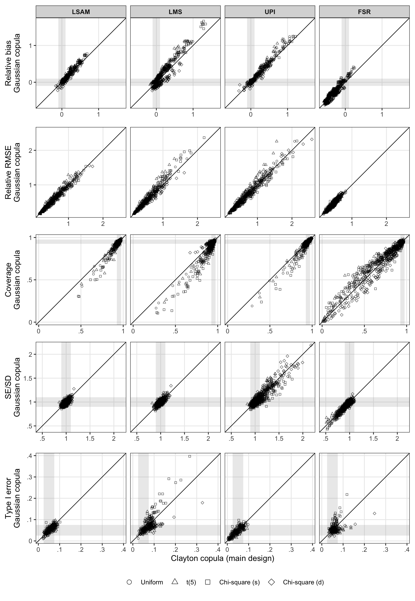
```

```{r}
#| label: fig-copula-a3
#| fig-cap: "Performance Measures of the Interaction Coefficient ($a_3$) Under the Gaussian Copula Against the Clayton Copula"
#| apa-note: "Each point is one condition, over all sample sizes, reliability levels, interaction magnitudes, and (mis)specification conditions, and its shape marks the predictor distribution. Points on the diagonal have the same value under both copulas. The gray bands mark the acceptable region for the measure on both axes, and no acceptable region is defined for the relative RMSE. Relative bias and relative RMSE exclude $a_3 = 0$ and the Type I error uses $a_3 = 0$ only. LSAM = local structural-after-measurement; LMS = latent moderated structural equations; UPI = unconstrained product indicator; FSR = factor score regression; (s) = same skewness; (d) = opposite skewness."
#| out-height: "7.4in"
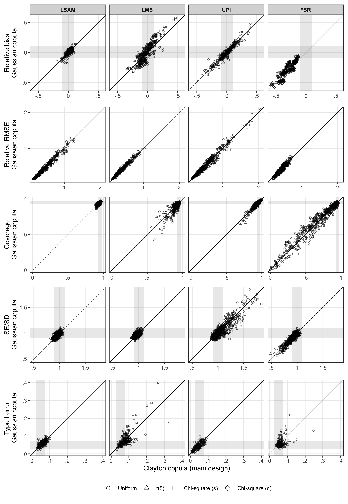
```

\FloatBarrier

```{r}
#| label: copula-setup
rob <- read_res(res_rob)
# the two runs number their conditions differently, because the robustness
# design drops the normal distribution. cells are therefore matched on the
# design factors, not on the condition label.
cell_keys <- c(setdiff(keys, "condition"), "method", "parameter")
pair <- function(clayton, gaussian) inner_join(
  filter(clayton,  criterion == "soft", parameter %in% c("a3", "imm")),
  filter(gaussian, criterion == "soft", parameter %in% c("a3", "imm")),
  by = cell_keys, suffix = c("_c", "_g"))
cop_s <- pair(main$summary, rob$summary)
cop_r <- pair(main$reject,  rob$reject) |> filter(a3 == 0)
# one row per cell for one measure: the gaussian minus clayton difference, the
# standard error of that difference (the two runs are independent, so their
# squared MCSEs add) and whether the verdict changes, that is, whether one
# value lies inside the acceptable band and the other outside.
cop_cell <- function(d, label, value, band) {
  g <- d[[paste0(value, "_g")]]; cl <- d[[paste0(value, "_c")]]
  tibble(parameter = d$parameter, method = d$method, measure = label,
         diff = g - cl,
         se   = sqrt(d[[paste0(value, "_mcse_g")]]^2 + d[[paste0(value, "_mcse_c")]]^2),
         flip = between(g, band[1], band[2]) != between(cl, band[1], band[2]))
}
# both estimands are zero at a3 = 0, where the summary reports absolute and not
# relative bias, so those cells are left out of the relative bias rows
cop <- bind_rows(
  cop_cell(filter(cop_s, a3 != 0), "Rel. bias", "rel_bias", c(-0.10, 0.10)),
  cop_cell(cop_s, "Coverage", "coverage", c(0.925, 0.975)),
  cop_cell(cop_r, "Type I error", "reject", c(0.025, 0.075))) |>
  mutate(measure   = factor(measure, unique(measure)),
         parameter = factor(parameter, c("a3", "imm"), c("$a_3$", "imm")),
         method    = factor(method, names(method_lab), method_lab))
```

\renewcommand{\tabfont}{\footnotesize}

```{r}
#| label: tbl-copula
#| tbl-cap: "Agreement of the Performance Verdicts Under the Clayton and the Gaussian Copula"
#| apa-note: "A verdict is whether the measure lies inside its acceptable region, $\\pm 0.10$ for relative bias, .925 to .975 for coverage, and .025 to .075 for the Type I error. Conditions is the number of matched conditions, over all sample sizes, reliability levels, nonnormal distributions, interaction magnitudes, and (mis)specification conditions. Relative bias excludes $a_3 = 0$ and the Type I error uses $a_3 = 0$ only. Same is the percentage of conditions with the same verdict under both copulas. Changed is the percentage with a different verdict, split by whether the difference between the two values is below (within MCSE) or at least (beyond MCSE) twice its Monte Carlo standard error, the square root of the sum of the two squared MCSEs. Largest is the largest absolute difference between the two values. imm = index of moderated mediation; LSAM = local structural-after-measurement; LMS = latent moderated structural equations; UPI = unconstrained product indicator; FSR = factor score regression."
tab <- cop |>
  group_by(parameter, measure, method) |>
  summarise(K = n(),
            same    = sprintf("%.1f", 100 * mean(!flip)),
            within  = sprintf("%.1f", 100 * mean(flip & abs(diff) <  2 * se)),
            beyond  = sprintf("%.1f", 100 * mean(flip & abs(diff) >= 2 * se)),
            largest = sprintf("%.3f", max(abs(diff))),
            .groups = "drop") |>
  mutate(K = blank(K, paste(parameter, measure)),
         measure = blank(measure, paste(parameter, measure)),
         parameter = blank(parameter, parameter))
tbl(tab, c("Estimand", "Measure", "Approach", "Conditions", "Same (\\%)",
           "Changed, within MCSE (\\%)", "Changed, beyond MCSE (\\%)", "Largest"),
    align = c(rep("l", 3), rep("r", 5)))
```

```{r}
#| label: copula-diff-setup
nonnormal <- c("uniform", "t5", "chisq_same", "chisq_diff")
mis_type  <- c(none = "none", c2 = "c2", c3 = "c3", crossload = "cl", rescov = "rc")
# signed, three decimals, set in math so the minus sign is typeset. a difference
# that rounds to zero is shown without a sign.
signed <- function(x) paste0("$", if_else(round(x, 3) == 0, "0.000", sprintf("%+.3f", x)), "$")
# mean gaussian minus clayton difference in one measure, by estimand, estimator
# and distribution, with one column per (mis)specification type
cop_diff_tbl <- function(d, value) {
  tab <- d |>
    mutate(diff = .data[[paste0(value, "_g")]] - .data[[paste0(value, "_c")]],
           mis = factor(mis_type[sub("_.*", "", misspec)], mis_type),
           parameter = factor(parameter, c("a3", "imm"), c("$a_3$", "imm")),
           method    = factor(method, names(method_lab), method_lab),
           distr_exo = factor(distr_exo, nonnormal, dist_lab[nonnormal])) |>
    group_by(parameter, method, distr_exo, mis) |>
    summarise(diff = signed(mean(diff)), .groups = "drop") |>
    tidyr::pivot_wider(names_from = mis, values_from = diff) |>
    mutate(method = blank(method, paste(parameter, method)),
           parameter = blank(parameter, parameter))
  tbl(tab, c("Estimand", "Approach", "Distribution", "None", "$c_2$", "$c_3$", "cl", "rc"),
      align = c(rep("l", 3), rep("r", 5)))
}
```

```{r}
#| label: tbl-copula-bias
#| tbl-cap: "Mean Difference in Relative Bias Between the Gaussian and the Clayton Copula by Distribution and (Mis)specification"
#| apa-note: "Each entry is the relative bias under the Gaussian copula minus the relative bias under the Clayton copula (main design), averaged over sample sizes, reliability levels, the two nonzero interaction magnitudes, and, for the (mis)specifications, the small and medium magnitude. None = correctly specified model; $c_2$ and $c_3$ = omitted paths; cl = omitted cross-loading; rc = omitted residual covariance. imm = index of moderated mediation; LSAM = local structural-after-measurement; LMS = latent moderated structural equations; UPI = unconstrained product indicator; FSR = factor score regression; (s) = same skewness; (d) = opposite skewness."
cop_diff_tbl(filter(cop_s, a3 != 0), "rel_bias")
```

```{r}
#| label: tbl-copula-rmse
#| tbl-cap: "Mean Difference in Relative RMSE Between the Gaussian and the Clayton Copula by Distribution and (Mis)specification"
#| apa-note: "Each entry is the relative RMSE under the Gaussian copula minus the relative RMSE under the Clayton copula (main design), averaged over sample sizes, reliability levels, the two nonzero interaction magnitudes, and, for the (mis)specifications, the small and medium magnitude. None = correctly specified model; $c_2$ and $c_3$ = omitted paths; cl = omitted cross-loading; rc = omitted residual covariance. imm = index of moderated mediation; LSAM = local structural-after-measurement; LMS = latent moderated structural equations; UPI = unconstrained product indicator; FSR = factor score regression; (s) = same skewness; (d) = opposite skewness."
cop_diff_tbl(filter(cop_s, a3 != 0), "rel_rmse")
```

```{r}
#| label: tbl-copula-coverage
#| tbl-cap: "Mean Difference in Coverage Between the Gaussian and the Clayton Copula by Distribution and (Mis)specification"
#| apa-note: "Each entry is the coverage under the Gaussian copula minus the coverage under the Clayton copula (main design), averaged over sample sizes, reliability levels, interaction magnitudes, and, for the (mis)specifications, the small and medium magnitude. None = correctly specified model; $c_2$ and $c_3$ = omitted paths; cl = omitted cross-loading; rc = omitted residual covariance. imm = index of moderated mediation; LSAM = local structural-after-measurement; LMS = latent moderated structural equations; UPI = unconstrained product indicator; FSR = factor score regression; (s) = same skewness; (d) = opposite skewness."
cop_diff_tbl(cop_s, "coverage")
```

```{r}
#| label: tbl-copula-sesd
#| tbl-cap: "Mean Difference in the SE/SD Ratio Between the Gaussian and the Clayton Copula by Distribution and (Mis)specification"
#| apa-note: "Each entry is the SE/SD ratio under the Gaussian copula minus the SE/SD ratio under the Clayton copula (main design), averaged over sample sizes, reliability levels, interaction magnitudes, and, for the (mis)specifications, the small and medium magnitude. None = correctly specified model; $c_2$ and $c_3$ = omitted paths; cl = omitted cross-loading; rc = omitted residual covariance. imm = index of moderated mediation; LSAM = local structural-after-measurement; LMS = latent moderated structural equations; UPI = unconstrained product indicator; FSR = factor score regression; (s) = same skewness; (d) = opposite skewness."
cop_diff_tbl(cop_s, "se_sd")
```

```{r}
#| label: tbl-copula-typei
#| tbl-cap: "Mean Difference in Type I Error Between the Gaussian and the Clayton Copula by Distribution and (Mis)specification"
#| apa-note: "Each entry is the Type I error under the Gaussian copula minus the Type I error under the Clayton copula (main design) at $a_3 = 0$, averaged over sample sizes, reliability levels, and, for the (mis)specifications, the small and medium magnitude. None = correctly specified model; $c_2$ and $c_3$ = omitted paths; cl = omitted cross-loading; rc = omitted residual covariance. imm = index of moderated mediation; LSAM = local structural-after-measurement; LMS = latent moderated structural equations; UPI = unconstrained product indicator; FSR = factor score regression; (s) = same skewness; (d) = opposite skewness."
cop_diff_tbl(cop_r, "reject")
```

```{r}
#| label: tbl-copula-moments
#| tbl-cap: "Population Moments of the Product Term Under the Clayton and the Gaussian Copula"
#| apa-note: "Covariances of the product term $XW$ with $X$ and with $W$, and its variance, in the population of each distribution, computed by numerical integration as in the calibration. Under normality the two covariances are $0$ and the variance is $1 + \\rho^2 = 1.09$. The normal condition uses the Gaussian copula in both designs. $\\chi^2$ (s) = same skewness; $\\chi^2$ (d) = opposite skewness."
# moments of the standardized predictors saved by the calibration of each run
prod_mom <- function(dir, copula) {
  m <- readRDS(file.path(dir, "calibration.rds"))$moments
  tibble(distr_exo = names(m), copula = copula,
         cov_x = sapply(m, `[[`, "x2w"), cov_w = sapply(m, `[[`, "xw2"),
         var_p = sapply(m, `[[`, "var_p"))
}
# the normal condition is the same bivariate normal in both runs
tab <- bind_rows(prod_mom(res_main, "Clayton"),
                 filter(prod_mom(res_rob, "Gaussian"), distr_exo != "normal")) |>
  mutate(copula = if_else(distr_exo == "normal", "Gaussian", copula),
         distr_exo = factor(distr_exo, names(dist_lab), dist_lab)) |>
  arrange(distr_exo, copula) |>
  transmute(distr_exo = blank(distr_exo, distr_exo), copula,
            cov_x = signed(cov_x), cov_w = signed(cov_w),
            var_p = sprintf("%.3f", var_p))
tbl(tab, c("Distribution", "Copula", "$\\operatorname{Cov}(X, XW)$",
           "$\\operatorname{Cov}(W, XW)$", "$\\operatorname{Var}(XW)$"),
    align = c("l", "l", rep("r", 3)))
```

\renewcommand{\tabfont}{}

\FloatBarrier
\newpage

# Complete Figures

The figures below show the complete results for the imm and the interaction
coefficient in every condition of the design. They are ordered by performance
measure, then by estimand, interaction magnitude, and reliability level, and
each shows all sample sizes, distributions, and (mis)specifications. Power is
shown at $a_3 = 0.2$. The first figure shows the relative bias of the
interaction coefficient under correct specification, and the last eight show the
remaining structural coefficients, the SE$^2$/VAR ratio, and the loading of the
cross-loaded indicator $m_3$ in the conditions named in their captions. In each
figure, LSAM = local structural-after-measurement, LMS = latent moderated
structural equations, UPI = unconstrained product indicator, FSR = factor score
regression, imm = index of moderated mediation, n = no misspecification, $c_2$
and $c_3$ = omitted paths, cl = omitted cross-loading, rc = omitted residual
covariance, and .s and .m = small and medium magnitude. Where shown, the gray
band marks the acceptable region for the measure, which for the SE$^2$/VAR ratio
is taken to be the same as for the SE/SD ratio (0.90 to 1.10), and the error
bars represent the Monte Carlo standard error (MCSE).

```{r}
#| label: fig-s-baseline-bias-a3
#| fig-cap: "Relative Bias of the Interaction Coefficient ($a_3$) Under the Correctly Specified Condition Across Sample Sizes, Reliability, Interaction Values, and Distributions"
#| out-width: "100%"
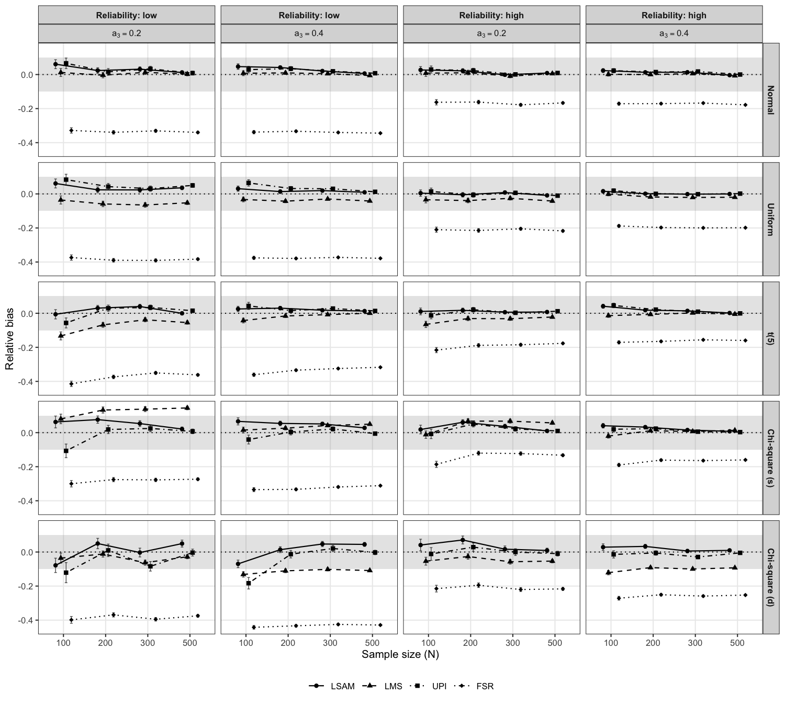
```

```{r}
#| label: complete-figures
#| output: asis
# one figure per measure, estimand, interaction magnitude and reliability level,
# in the order given in the text. the file names are those written by figures.R.
# relative bias, SE/SD and coverage have one figure per estimand, the other
# measures show both estimands in one figure.
measure_lab  <- c(rel_bias = "Relative Bias of", rel_rmse = "Relative RMSE of",
                  se_sd = "SE/SD of", coverage = "Coverage of",
                  typeI = "Type I Error of", power = "Power for")
estimand_lab <- c(imm = "the imm ($a_3 b$)", a3 = "the Interaction Coefficient ($a_3$)",
                  both = "the imm ($a_3 b$) and the Interaction Coefficient ($a_3$)")
fig_rows <- function(measure, estimand, a3)
  expand.grid(rel = c("low", "high"), a3 = a3, estimand = estimand, measure = measure,
              stringsAsFactors = FALSE)
figs <- rbind(fig_rows("rel_bias", c("imm", "a3"), c(0.2, 0.4)),
              fig_rows("rel_rmse", "both", c(0.2, 0.4)),
              fig_rows("se_sd", c("imm", "a3"), c(0.2, 0.4)),
              fig_rows("coverage", c("imm", "a3"), c(0.2, 0.4)),
              fig_rows("typeI", "both", 0),
              fig_rows("power", "both", 0.2))
chunks <- with(figs, sprintf(
  '```{r}\n#| label: fig-s-%s-%s-%s-%s\n#| fig-cap: "%s %s Across Distributions, Sample Sizes, and (Mis)specifications at %s Reliability and $a_3 = %s$"\n#| out-width: "%s"\nknitr::include_graphics("../plots/%s_%s_a3-%s_%s.png")\n```',
  tolower(sub("_", "-", measure)), estimand, sub(".", "", a3, fixed = TRUE), rel,
  measure_lab[measure], estimand_lab[estimand], tools::toTitleCase(rel), a3,
  ifelse(estimand == "both", "100%", "6.3in"),
  estimand, measure, a3, rel))
cat(knitr::knit_child(text = chunks, quiet = TRUE), sep = "\n\n")
```

```{r}
#| label: fig-s-param-bias
#| fig-cap: "Relative Bias of the Structural Coefficients ($a_1$, $a_2$, $b$, $c'$) Across Distributions and (Mis)specifications at High Reliability, $N = 500$, and $a_3 = 0.2$"
#| out-width: "6.3in"
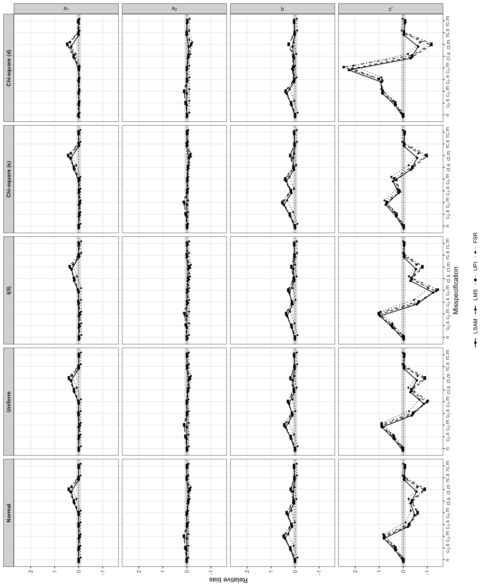
```

```{r}
#| label: fig-s-param-coverage
#| fig-cap: "Coverage of the Structural Coefficients ($a_1$, $a_2$, $b$, $c'$) Across Distributions and (Mis)specifications at High Reliability, $N = 500$, and $a_3 = 0.2$"
#| out-width: "6.3in"
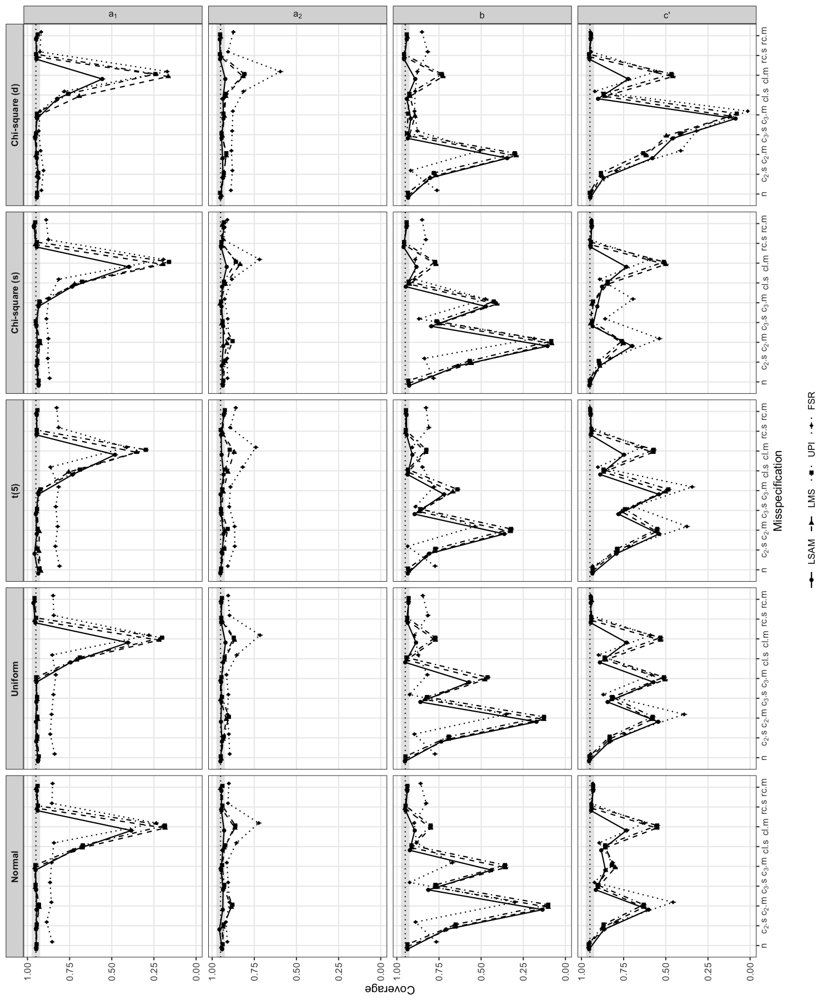
```

```{r}
#| label: fig-s-param-sesd
#| fig-cap: "SE/SD of the Structural Coefficients ($a_1$, $a_2$, $b$, $c'$) Across Distributions and (Mis)specifications at High Reliability, $N = 500$, and $a_3 = 0.2$"
#| out-width: "6.3in"
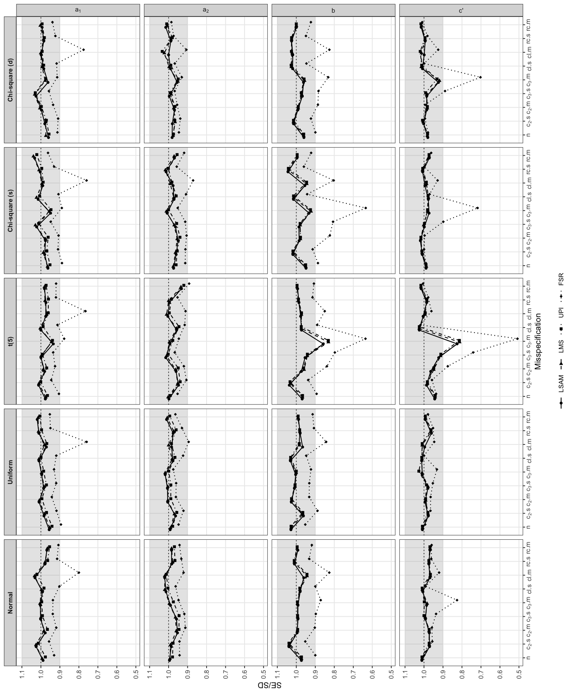
```

```{r}
#| label: fig-s-param-coverage-low
#| fig-cap: "Coverage of the Structural Coefficients ($a_1$, $a_2$, $b$, $c'$) Across Distributions and (Mis)specifications at Low Reliability, $N = 500$, and $a_3 = 0.2$"
#| out-width: "6.3in"
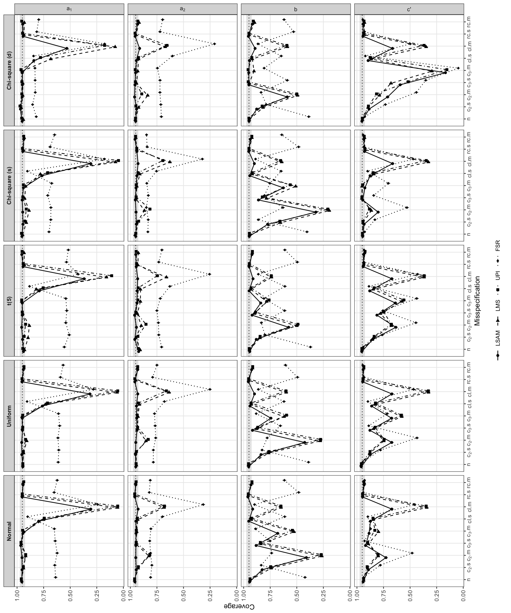
```

```{r}
#| label: fig-s-param-sesd-low
#| fig-cap: "SE/SD of the Structural Coefficients ($a_1$, $a_2$, $b$, $c'$) Across Distributions and (Mis)specifications at Low Reliability, $N = 500$, and $a_3 = 0.2$"
#| out-width: "6.3in"
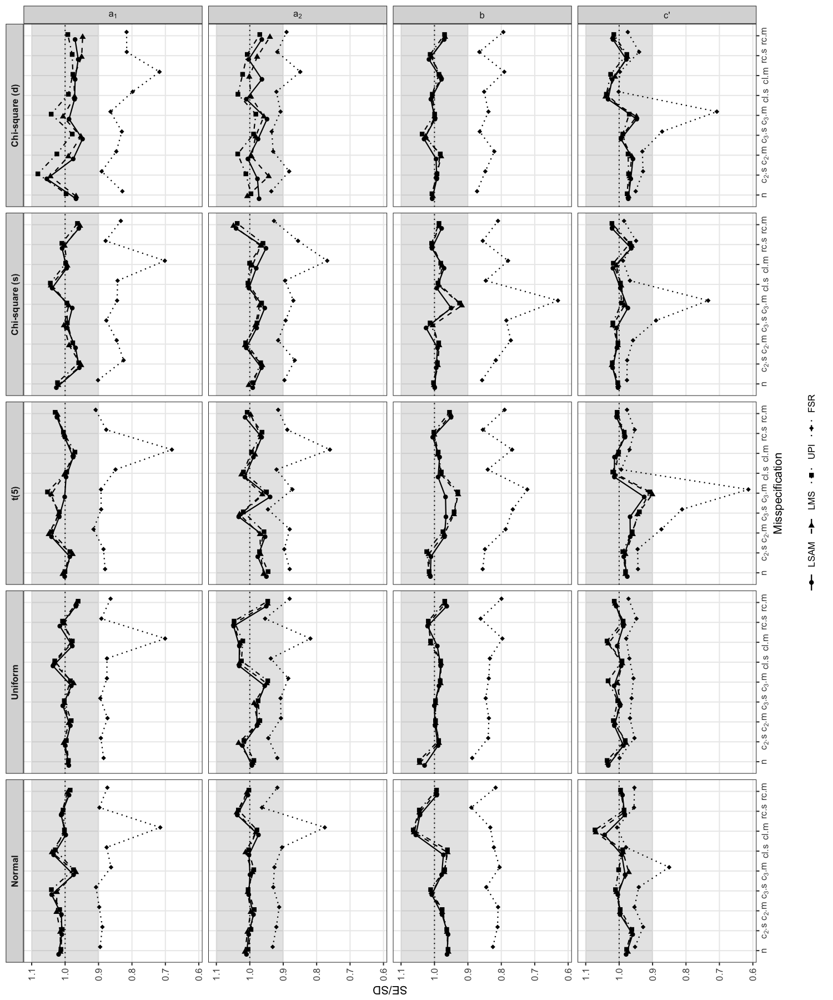
```

```{r}
#| label: fig-s-relvar-high
#| fig-cap: "SE$^2$/VAR Ratio of the imm ($a_3 b$) and the Interaction Coefficient ($a_3$) Across Distributions and (Mis)specifications at High Reliability for $N = 200$ and $500$ at $a_3 = 0.2$"
#| apa-note: "The vertical axis is truncated at 2.5 for visualization. One ratio lies above it and is not shown (7.00, for LMS and the imm with $t_5$ predictors under the medium cross-loading at $N = 200$)."
#| out-width: "6.3in"
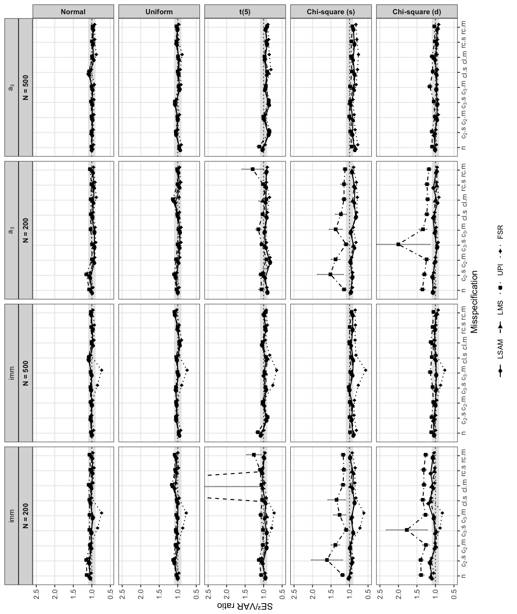
```

```{r}
#| label: fig-s-relvar-low
#| fig-cap: "SE$^2$/VAR Ratio of the imm ($a_3 b$) and the Interaction Coefficient ($a_3$) Across Distributions and (Mis)specifications at Low Reliability for $N = 200$ and $500$ at $a_3 = 0.2$"
#| apa-note: "The vertical axis is truncated at 2.5 for visualization. The ratios of UPI at $N = 200$ lie above it and are not shown with $\\chi^2$ predictors in every condition (2.70 to 6.68) and with $t_5$ predictors under correct specification (about 3.6)."
#| out-width: "6.3in"
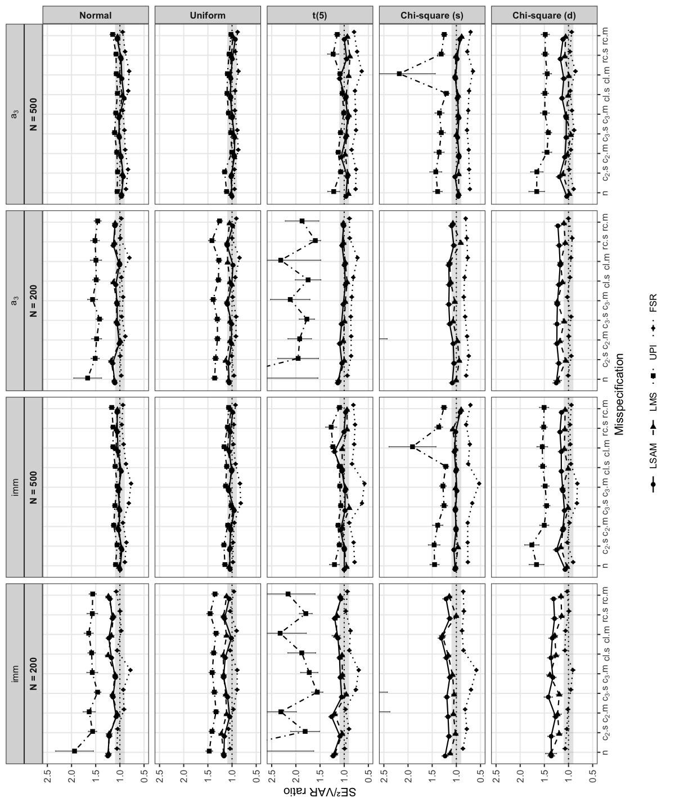
```

```{r}
#| label: fig-s-load
#| fig-cap: "Relative Bias, Coverage, SE/SD, and SE$^2$/VAR Ratio of the Loading of the Cross-Loaded Mediator Indicator ($m_3$) Across Distributions and (Mis)specifications at High Reliability, $N = 500$, and $a_3 = 0.2$"
#| out-width: "100%"
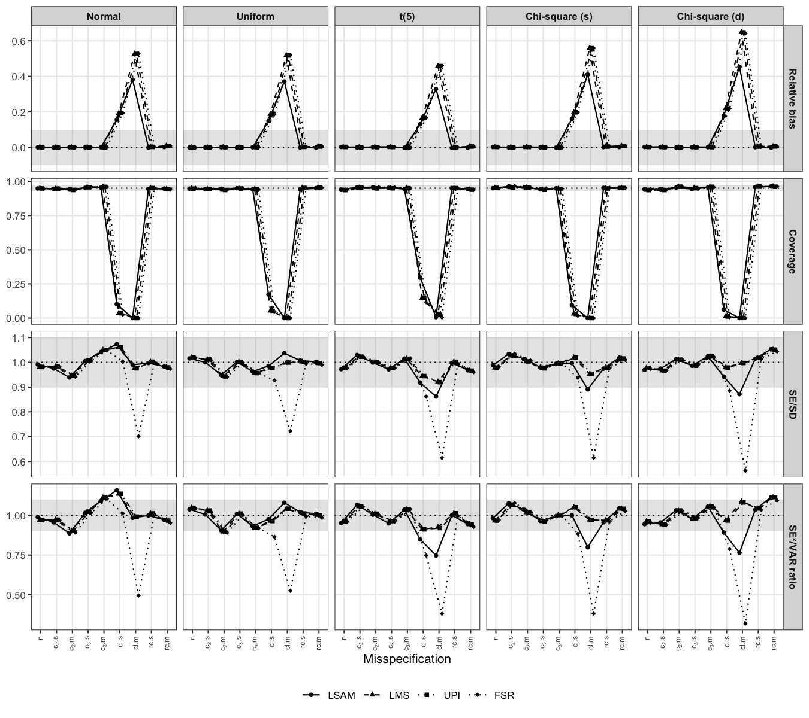
```

\newpage

# References

::: {#refs}
:::
