```{r}
#| label: setup
library(dplyr); library(knitr)

res_main <- "../results_main"
res_rob  <- "../results_robustness"

keys       <- c("condition", "n", "a3", "rel", "distr_exo", "misspec")
measures   <- c(rel_bias = "Rel. bias", rel_rmse = "Rel. RMSE",
                se_sd = "SE/SD", coverage = "Coverage", reject = "Rejection")
dist_lab   <- c(normal = "Normal", uniform = "Uniform", t5 = "$t_5$",
                chisq_same = "$\\chi^2$ (s)", chisq_diff = "$\\chi^2$ (d)")
method_lab <- c(lsam = "LSAM", lms = "LMS", dblcent = "UPI", fsr = "FSR")
rel_lab    <- c(low = "Low", high = "High")

read_res <- function(dir) list(
  summary = readRDS(file.path(dir, "summary.rds")),
  reject  = readRDS(file.path(dir, "rejection_imm_a3.rds")),
  report  = readRDS(file.path(dir, "convergence_report.rds")))
main <- read_res(res_main)

# largest absolute difference in each measure between two sets of results, per
# group. the two sets are joined on condition, method and parameter, so every
# difference compares the same cell. the maximum runs over methods, estimands
# and every design factor not in `by`.
max_diff <- function(ref_s, alt_s, ref_r, alt_r, by) {
  s <- inner_join(ref_s, alt_s, by = c(keys, "method", "parameter"),
                  suffix = c("", "_alt")) |>
    group_by(across(all_of(by))) |>
    summarise(across(c(rel_bias, rel_rmse, se_sd, coverage),
                     ~ max(abs(.x - get(paste0(cur_column(), "_alt"))), na.rm = TRUE)),
              .groups = "drop")
  r <- inner_join(ref_r, alt_r, by = c(keys, "method", "parameter"),
                  suffix = c("", "_alt")) |>
    group_by(across(all_of(by))) |>
    summarise(reject = max(abs(reject - reject_alt), na.rm = TRUE), .groups = "drop")
  inner_join(s, r, by = by) |> arrange(across(all_of(by)))
}

# a label is printed once per block: repeated values of x within g are blanked
blank <- function(x, g) if_else(duplicated(g), "", as.character(x))

tbl <- function(d, col_names, align = NULL) {
  kable(d, booktabs = TRUE, format = "latex", digits = 3, row.names = FALSE,
        escape = FALSE, linesep = "", align = align, col.names = col_names)
}
```

\newpage

# Realized Reliability and Explained Variance

```{r}
#| label: rel-r2-setup
# design.rds has no condition column, so it is rebuilt from the row order
design <- readRDS(file.path(res_main, "design.rds")) |>
  mutate(condition = sprintf("c%04d", row_number()))
met_rep <- readRDS(file.path(res_main, "metrics_mc.rds")) |>
  inner_join(design, by = "condition")
qty <- c("rel_X", "rel_W", "rel_M", "rel_Y", "R2_M", "R2_Y")
# per cell: mean over the pooled replications and its Monte Carlo standard
# error, sd over replications divided by the square root of their number
met <- met_rep |>
  group_by(distr_exo, a3, rel, misspec) |>
  summarise(K = n(),
            across(all_of(qty), list(m = mean, se = ~ sd(.x) / sqrt(n()))),
            .groups = "drop") |>
  mutate(distr_exo = factor(distr_exo, names(dist_lab), dist_lab),
         rel = factor(rel, names(rel_lab), rel_lab))
n_pooled <- unique(met$K)
mcse_rel <- max(select(met, ends_with("_se") & starts_with("rel")))
mcse_r2  <- max(select(met, ends_with("_se") & starts_with("R2")))
# "mean (MCSE)" with the leading zero dropped, as both are bounded by one
cell <- function(m, se) sprintf("%s (%s)", sub("^0", "", sprintf("%.3f", m)),
                                sub("^0", "", sprintf("%.4f", se)))
# one formatted column per entry of spec, each c(quantity, misspecification),
# joined on the grouping columns `by`
pick <- function(d, spec, by) {
  cols <- Map(function(s, name) d |>
                filter(misspec == s[2]) |>
                transmute(across(all_of(by)),
                          !!name := cell(.data[[paste0(s[1], "_m")]],
                                         .data[[paste0(s[1], "_se")]])),
              spec, names(spec))
  Reduce(function(a, b) inner_join(a, b, by = by), cols)
}
```

The indicator error variances were calibrated under normality to the target reliability and then held fixed across the predictor distributions, and the structural disturbance variances were set so that $R^2 \approx 0.3$ for $M$ and $Y$ under normality, correct specification, and $a_3 = 0.2$. Because the variance of the product term and of $M$ depends on the predictor distribution and on $a_3$, the realized reliability of the $M$ and $Y$ indicators and the explained variance of both equations vary across conditions. @tbl-reliability and @tbl-r2 report their realized values, computed in every generated dataset as the mean over the four indicators of $\lambda_j^2 \operatorname{Var}(\eta) / \operatorname{Var}(z_{\eta j})$ and as the variance of the structural part over the variance of the latent outcome, and averaged over replications and sample sizes. Under the cross-loading, the $m_3$ indicator carries variance from $X$ that the formula does not count as true-score variance, so the reliability of $M$ falls by construction. Under $c_2$ and $c_3$, the $Y$ indicator error variances were rescaled to keep the reliability of $Y$ at its baseline value, so only its $R^2$ rises. The residual covariance leaves both quantities unchanged. Each tabled value is a mean over `r format(n_pooled, big.mark = ",")` replications in @tbl-reliability and twice that in @tbl-r2, with its Monte Carlo standard error in parentheses, at most `r sprintf("%.4f", mcse_rel)` for the reliabilities and `r sprintf("%.4f", mcse_r2)` for the $R^2$ values.

\renewcommand{\tabfont}{\footnotesize}

```{r}
#| label: tbl-reliability
#| tbl-cap: "Realized Reliability of the Indicators by Distribution, Interaction Magnitude, and Reliability Level"
#| apa-note: "Mean reliability of the four indicators of each latent variable, averaged over replications and sample sizes, under the correctly specified model, with the Monte Carlo standard error in parentheses. The last two columns give the reliability of $M$ under the small and medium cross-loading, the only (mis)specification that changes it. Targets are .5 (low) and .7 (high)."
by  <- c("rel", "distr_exo", "a3")
tab <- pick(met, list(X = c("rel_X", "none"), W = c("rel_W", "none"),
                      M = c("rel_M", "none"), Y = c("rel_Y", "none"),
                      cl_s = c("rel_M", "crossload_small"),
                      cl_m = c("rel_M", "crossload_medium")), by) |>
  arrange(rel, distr_exo, a3) |>
  mutate(distr_exo = blank(distr_exo, paste(rel, distr_exo)), rel = blank(rel, rel))
tbl(tab, c("Reliability", "Distribution", "$a_3$", "$X$", "$W$", "$M$", "$Y$",
           "$M$ (cl.s)", "$M$ (cl.m)"), align = c("l", "l", rep("r", 7)))
```

```{r}
#| label: tbl-r2
#| tbl-cap: "Explained Variance of the Mediator and Outcome Equations by Distribution, Interaction Magnitude, and Structural (Mis)specification"
#| apa-note: "$R^2$ of the latent $M$ and $Y$ equations, averaged over replications, sample sizes, and reliability levels, with the Monte Carlo standard error in parentheses. $R^2_M$ is the same under every (mis)specification. $R^2_Y$ is shown under the correctly specified model (none) and under the small (s) and medium (m) omitted paths $c_2$ and $c_3$, which add explained variance to $Y$. The measurement (mis)specifications leave both values unchanged."
# pooled over reliability levels as well
r2 <- met_rep |>
  group_by(distr_exo, a3, misspec) |>
  summarise(across(c(R2_M, R2_Y), list(m = mean, se = ~ sd(.x) / sqrt(n()))), .groups = "drop") |>
  mutate(distr_exo = factor(distr_exo, names(dist_lab), dist_lab))
by  <- c("distr_exo", "a3")
tab <- pick(r2, list(R2M = c("R2_M", "none"), none = c("R2_Y", "none"),
                     c2_s = c("R2_Y", "c2_small"), c2_m = c("R2_Y", "c2_medium"),
                     c3_s = c("R2_Y", "c3_small"), c3_m = c("R2_Y", "c3_medium")), by) |>
  arrange(distr_exo, a3) |>
  mutate(distr_exo = blank(distr_exo, distr_exo))
tbl(tab, c("Distribution", "$a_3$", "$R^2_M$", "$R^2_Y$ none", "$R^2_Y$ $c_2$.s",
           "$R^2_Y$ $c_2$.m", "$R^2_Y$ $c_3$.s", "$R^2_Y$ $c_3$.m"), align = c("l", rep("r", 7)))
```

\renewcommand{\tabfont}{}

\FloatBarrier
\newpage

# Sensitivity to Outlier Screening

The main text reports performance measures after removing, condition-wide, every replication flagged as an outlier on any estimation approach, that is, an estimate beyond three interquartile ranges from the quartiles or a standard error above 10 on any structural parameter. As a sensitivity check, all measures were recomputed with the screening switched off, retaining every converged replication. @tbl-outliers reports, for each sample size, reliability level, and estimation approach, the proportion of replications removed and the largest absolute difference in each performance measure between the reported value and the value with the removed replications retained, taken over all estimands, predictor distributions, interaction magnitudes, and (mis)specification conditions.

```{r}
#| label: tbl-outliers
#| tbl-cap: "Largest Change in Each Performance Measure When Outliers Are Retained"
#| apa-note: "Removed is the mean and, in parentheses, the maximum percentage of replications removed by the outlier screening over the conditions at that sample size and reliability level. Removal is condition-wide, so it is shown once per block. The remaining columns give, for each estimation approach, the largest absolute difference between the reported measure and the measure computed without screening, over all estimands, distributions, interaction magnitudes, and (mis)specification conditions. Rel. = relative. Rejection is the Type I error at $a_3 = 0$ and the power at $a_3 = 0.2$ for the imm and $a_3$. LSAM = local structural-after-measurement; LMS = latent moderated structural equations; UPI = unconstrained product indicator; FSR = factor score regression."
by    <- c("rel", "n", "method")
ref_s <- filter(main$summary, criterion == "soft")
alt_s <- filter(main$summary, criterion == "unscreened")
ref_r <- filter(main$reject,  criterion == "soft")
alt_r <- filter(main$reject,  criterion == "unscreened")
# removal is condition-wide, so the percentage is shown once per block
removed <- main$report |>
  filter(criterion == "soft") |>
  distinct(across(all_of(keys)), n_reps, n_final) |>
  mutate(pct = 100 * (n_reps - n_final) / n_reps) |>
  group_by(rel, n) |>
  summarise(removed = sprintf("%.1f (%.1f)", mean(pct), max(pct)), .groups = "drop")
tab <- max_diff(ref_s, alt_s, ref_r, alt_r, by) |>
  inner_join(removed, by = c("rel", "n")) |>
  mutate(rel = factor(rel, names(rel_lab), rel_lab),
         method = factor(method, names(method_lab), method_lab)) |>
  arrange(rel, n, method) |>
  mutate(removed = blank(removed, paste(rel, n))) |>
  select(rel, n, removed, method, all_of(names(measures)))
tbl(tab, c("Reliability", "$N$", "Removed", "Estimator", unname(measures)))
```

\FloatBarrier
\newpage

# Extreme Standard Errors and the SE/SD Ratio

The main text reports SE/SD ratios above 1.10 for UPI at low reliability and small sample sizes. To examine whether that overestimation reflects a few replications with very large standard errors rather than a general overstatement of uncertainty, a standard error was classified as extreme when it lay more than three interquartile ranges above the upper quartile of its cell, and the ratio was recomputed with those replications dropped from the mean standard error only. The standard deviation of the estimates keeps every replication, since it is the quantity the standard errors are meant to track. @tbl-se-extreme lists every condition at $a_3 = 0.2$ under correct specification, the condition shown in the main text, in which the SE/SD ratio of the interaction coefficient or the imm exceeds 1.10.

```{r}
#| label: tbl-se-extreme
#| tbl-cap: "Conditions With an SE/SD Ratio Above 1.10 at $a_3 = 0.2$ Under Correct Specification, With and Without Extreme Standard Errors"
#| apa-note: "Extreme SEs is the percentage of replications in the cell whose standard error lies more than three interquartile ranges above the upper quartile. SE/SD is the ratio as reported in the main text, the mean standard error over the standard deviation of the estimates. The last column gives the same ratio after removing the extreme standard errors from the mean, with the standard deviation unchanged. imm = index of moderated mediation; UPI = unconstrained product indicator; (s) = same skewness; (d) = opposite skewness."
tab <- readRDS(file.path(res_main, "se_extremes.rds")) |>
  filter(criterion == "soft", misspec == "none", a3 == 0.2, se_sd > 1.10) |>
  mutate(parameter = factor(parameter, c("a3", "imm"), c("$a_3$", "imm")),
         method = factor(method, names(method_lab), method_lab),
         rel = factor(rel, names(rel_lab), rel_lab),
         distr_exo = factor(distr_exo, names(dist_lab), dist_lab)) |>
  arrange(parameter, method, rel, n, distr_exo) |>
  transmute(parameter, method, rel, n, distr_exo,
            ext = sprintf("%.1f", pct_ext),
            ratio = sprintf("%.2f", se_sd),
            trim = sprintf("%.2f", se_sd_trim)) |>
  mutate(n = blank(n, paste(parameter, method, rel, n)),
         rel = blank(rel, paste(parameter, method, rel)),
         method = blank(method, paste(parameter, method)),
         parameter = blank(parameter, parameter))
tbl(tab, c("Estimand", "Estimator", "Reliability", "$N$", "Distribution",
           "Extreme SEs (\\%)", "SE/SD", "SE/SD, removed"), align = c(rep("l", 5), rep("r", 3)))
```

\FloatBarrier
\newpage

# Robustness to the Copula

In the main design, the normal condition draws the latent predictors through a Gaussian copula, whereas the four nonnormal conditions combine nonnormal margins with a Clayton copula. The nonnormal conditions therefore differ from the normal condition in the dependence structure as well as in the margins. To separate the two, the four nonnormal conditions were regenerated with a Gaussian copula, so that only the margins differ from the normal condition, with every other aspect of the design, including the calibrated misspecification magnitudes, held fixed. @tbl-copula reports, for each sample size, reliability level, and nonnormal distribution, the largest absolute difference in each performance measure between the Clayton and the Gaussian copula results.

```{r}
#| label: tbl-copula
#| tbl-cap: "Largest Change in Each Performance Measure Under a Gaussian Instead of a Clayton Copula"
#| apa-note: "Each entry is the largest absolute difference between the measure under the Clayton copula (main design) and under the Gaussian copula, over all estimation approaches, estimands, interaction magnitudes, and (mis)specification conditions at that sample size, reliability level, and distribution. Rel. = relative. Rejection is the Type I error at $a_3 = 0$ and the power at $a_3 = 0.2$ for the imm and $a_3$."
if (!file.exists(file.path(res_rob, "summary.rds"))) {
  cat("Pending. Run the robustness simulation (copula_robustness = TRUE) and analyze_mc.R.")
} else {
  rob <- read_res(res_rob)
  by  <- c("distr_exo", "n", "rel")
  nonnormal <- c("uniform", "t5", "chisq_same", "chisq_diff")
  ref_s <- filter(main$summary, criterion == "soft", distr_exo %in% nonnormal)
  alt_s <- filter(rob$summary,  criterion == "soft", distr_exo %in% nonnormal)
  ref_r <- filter(main$reject,  criterion == "soft", distr_exo %in% nonnormal)
  alt_r <- filter(rob$reject,   criterion == "soft", distr_exo %in% nonnormal)
  tab <- max_diff(ref_s, alt_s, ref_r, alt_r, by) |>
    mutate(distr_exo = factor(distr_exo, nonnormal, dist_lab[nonnormal]),
           rel = factor(rel, names(rel_lab), rel_lab)) |>
    arrange(distr_exo, rel, n) |>
    select(distr_exo, rel, n, all_of(names(measures)))
  tbl(tab, c("Distribution", "Reliability", "$N$", unname(measures)))
}
```

\FloatBarrier
\newpage

# Complete Figures

The figures below show the complete results from which the figures in the main text were drawn. In each, LSAM = local structural-after-measurement, LMS = latent moderated structural equations, UPI = unconstrained product indicator, FSR = factor score regression, imm = index of moderated mediation, and n = no misspecification. Where shown, the gray band marks the acceptable region for the measure and the error bars represent the Monte Carlo standard error (MCSE).

```{r}
#| label: fig-s-baseline-bias-imm
#| fig-cap: "Relative Bias of the imm ($a_3 b$) Under the Correctly Specified Condition Across Sample Sizes, Reliability, Interaction Values, and Distributions"
#| out-width: "100%"
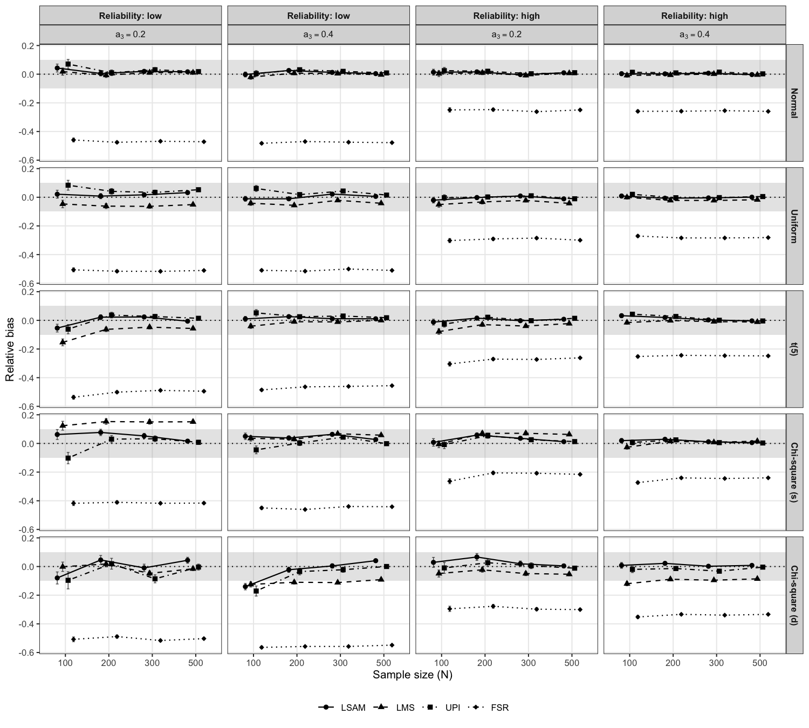
```

```{r}
#| label: fig-s-baseline-bias-a3
#| fig-cap: "Relative Bias of the Interaction Coefficient ($a_3$) Under the Correctly Specified Condition Across Sample Sizes, Reliability, Interaction Values, and Distributions"
#| out-width: "100%"
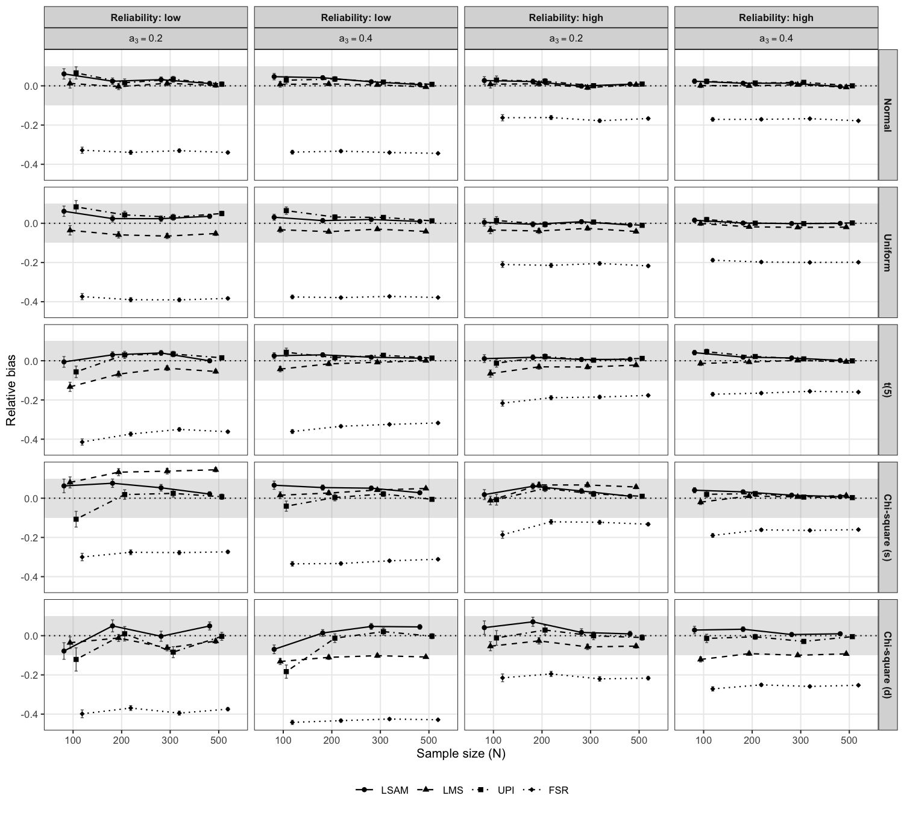
```

```{r}
#| label: fig-s-bias-imm
#| fig-cap: "Relative Bias of the imm ($a_3 b$) Across Distributions, Reliability, and (Mis)specifications for $N = 200$ and $500$ at $a_3 = 0.2$"
#| out-width: "6.3in"
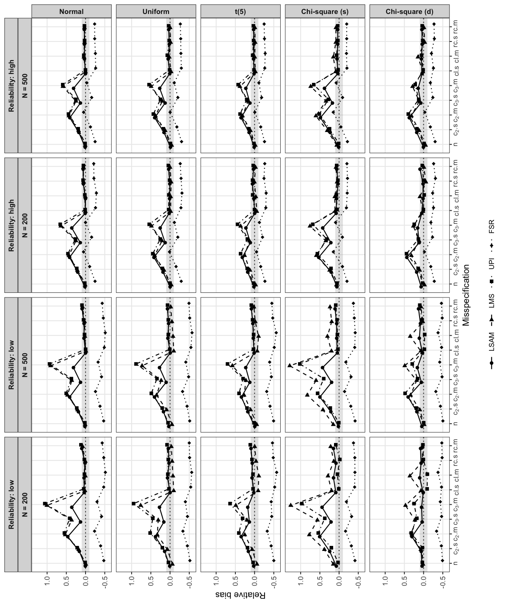
```

```{r}
#| label: fig-s-bias-a3
#| fig-cap: "Relative Bias of the Interaction Coefficient ($a_3$) Across Distributions, Reliability, and (Mis)specifications for $N = 200$ and $500$ at $a_3 = 0.2$"
#| out-width: "6.3in"
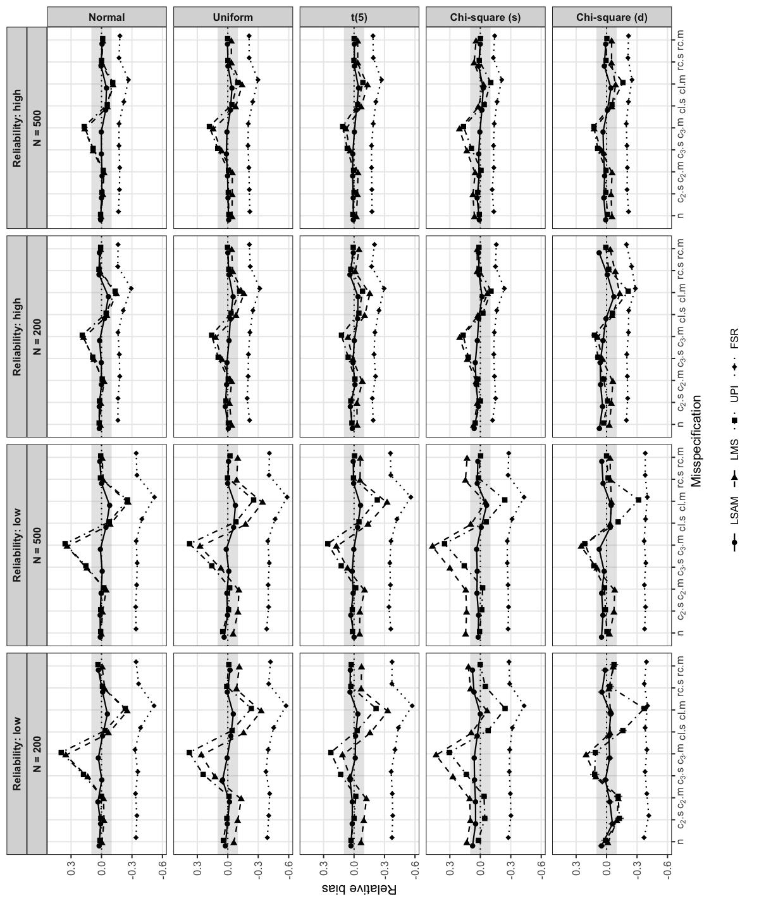
```

```{r}
#| label: fig-s-rmse
#| fig-cap: "Relative RMSE of the imm ($a_3 b$) and the Interaction Coefficient ($a_3$) Across Distributions, Reliability, and (Mis)specifications for $N = 200$ and $500$ at $a_3 = 0.2$"
#| out-width: "100%"
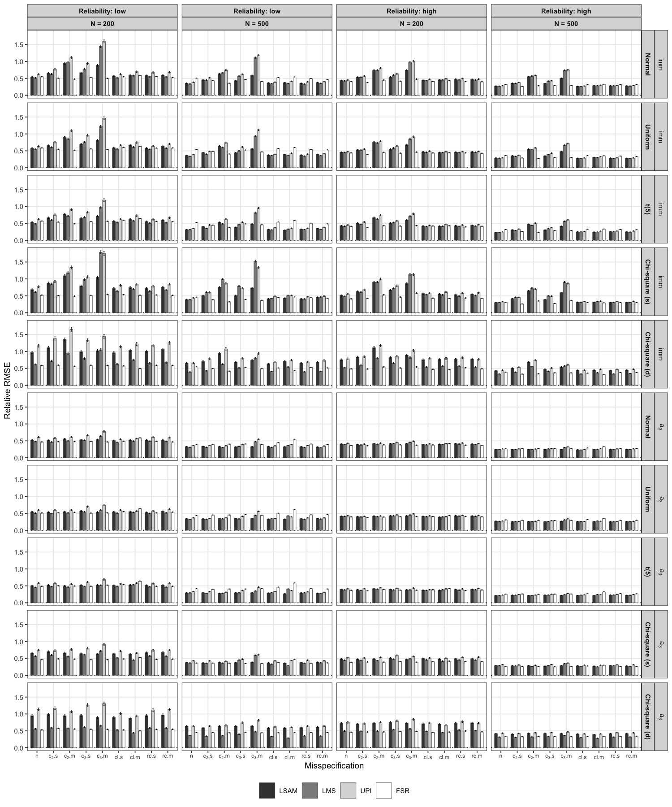
```

```{r}
#| label: fig-s-sesd-imm
#| fig-cap: "SE/SD of the imm ($a_3 b$) Across Distributions, Reliability, and (Mis)specifications for $N = 200$ and $500$ at $a_3 = 0.2$"
#| out-width: "6.3in"
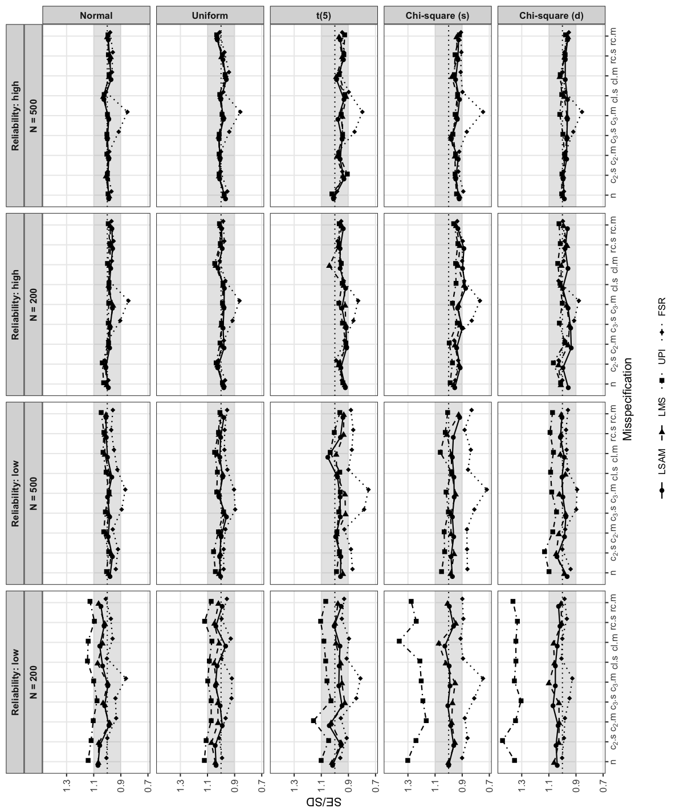
```

```{r}
#| label: fig-s-sesd-a3
#| fig-cap: "SE/SD of the Interaction Coefficient ($a_3$) Across Distributions, Reliability, and (Mis)specifications for $N = 200$ and $500$ at $a_3 = 0.2$"
#| out-width: "6.3in"

```

```{r}
#| label: fig-s-coverage-imm
#| fig-cap: "Coverage of the imm ($a_3 b$) Across Distributions, Reliability, and (Mis)specifications for $N = 200$ and $500$ at $a_3 = 0.2$"
#| out-width: "6.3in"
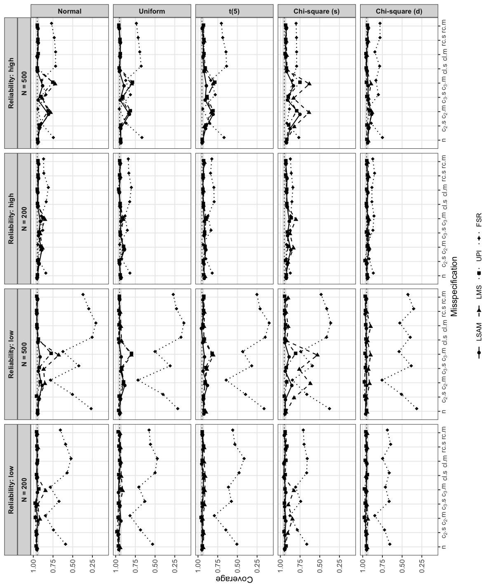
```

```{r}
#| label: fig-s-coverage-a3
#| fig-cap: "Coverage of the Interaction Coefficient ($a_3$) Across Distributions, Reliability, and (Mis)specifications for $N = 200$ and $500$ at $a_3 = 0.2$"
#| out-width: "6.3in"
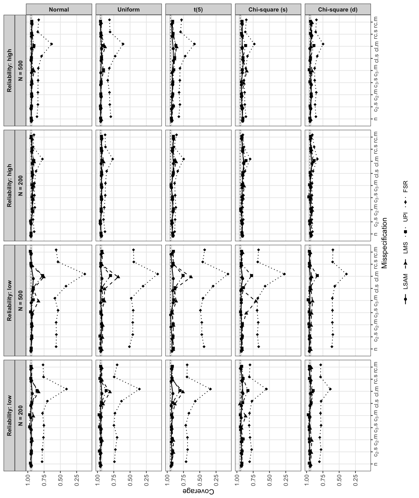
```

```{r}
#| label: fig-s-typei
#| fig-cap: "Type I Error of the imm ($a_3 b$) and the Interaction Coefficient ($a_3$) Across Distributions, Reliability, and (Mis)specifications for $N = 200$ and $500$ at $a_3 = 0$"
#| out-width: "100%"
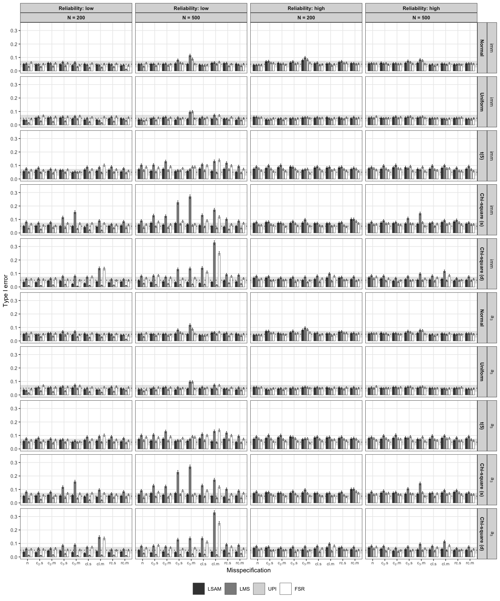
```

```{r}
#| label: fig-s-power
#| fig-cap: "Power for the imm ($a_3 b$) and the Interaction Coefficient ($a_3$) Across Distributions, Reliability, and (Mis)specifications for $N = 200$ and $500$ at $a_3 = 0.2$"
#| out-width: "100%"
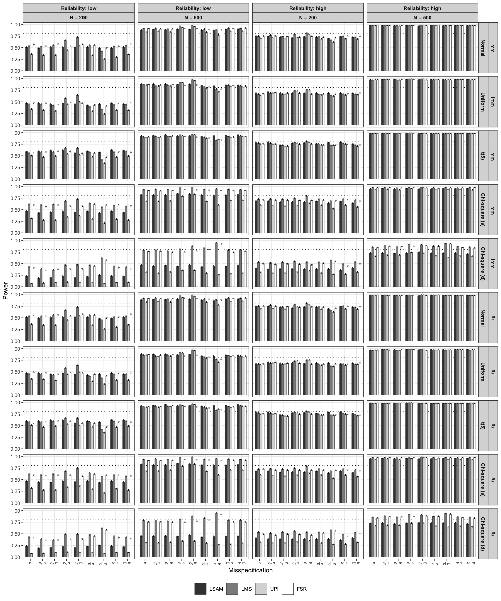
```

```{r}
#| label: fig-s-param-bias
#| fig-cap: "Relative Bias of the Structural Coefficients ($a_1$, $a_2$, $b$, $c'$) Across Distributions and (Mis)specifications at High Reliability, $N = 500$, and $a_3 = 0.2$"
#| out-width: "6.3in"
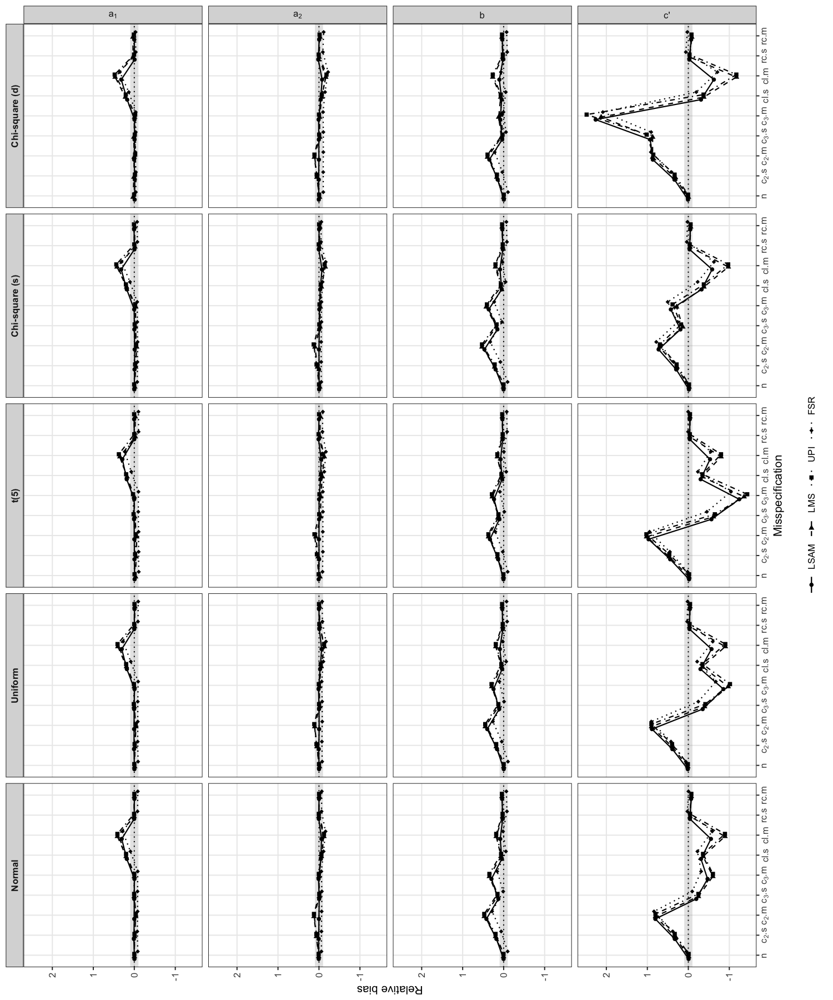
```

```{r}
#| label: fig-s-param-coverage
#| fig-cap: "Coverage of the Structural Coefficients ($a_1$, $a_2$, $b$, $c'$) Across Distributions and (Mis)specifications at High Reliability, $N = 500$, and $a_3 = 0.2$"
#| out-width: "6.3in"
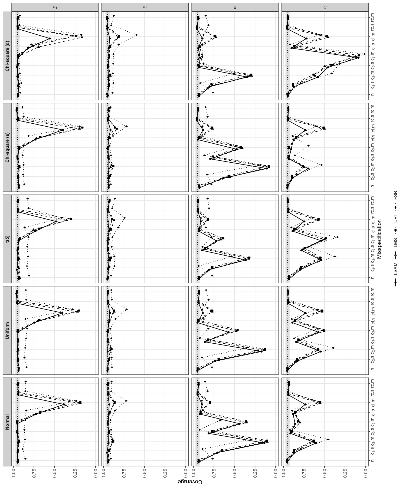
```

```{r}
#| label: fig-s-param-sesd
#| fig-cap: "SE/SD of the Structural Coefficients ($a_1$, $a_2$, $b$, $c'$) Across Distributions and (Mis)specifications at High Reliability, $N = 500$, and $a_3 = 0.2$"
#| out-width: "6.3in"
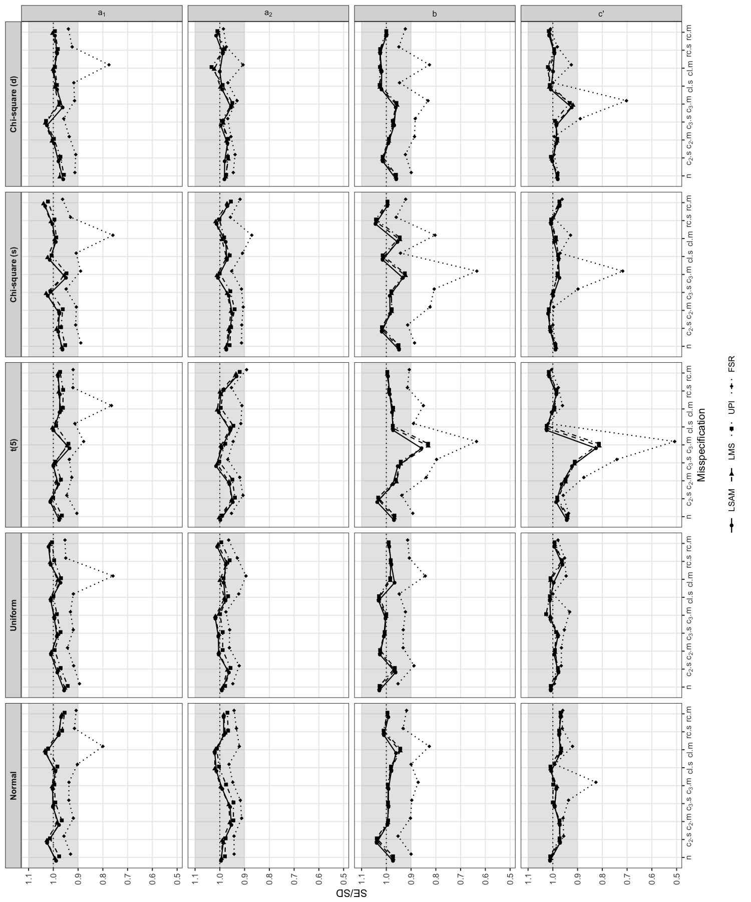
```

```{r}
#| label: fig-s-relvar-high
#| fig-cap: "SE$^2$/VAR Ratio of the imm ($a_3 b$) and the Interaction Coefficient ($a_3$) Across Distributions and (Mis)specifications at High Reliability for $N = 200$ and $500$ at $a_3 = 0.2$"
#| out-width: "6.3in"
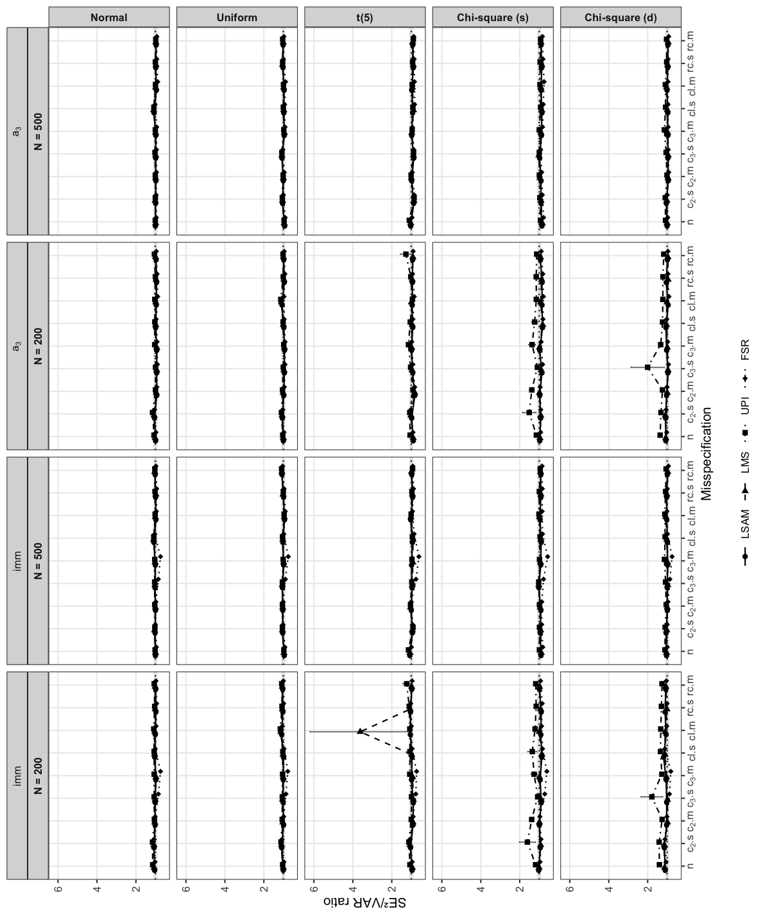
```

```{r}
#| label: fig-s-relvar-low
#| fig-cap: "SE$^2$/VAR Ratio of the imm ($a_3 b$) and the Interaction Coefficient ($a_3$) Across Distributions and (Mis)specifications at Low Reliability for $N = 200$ and $500$ at $a_3 = 0.2$"
#| out-width: "6.3in"
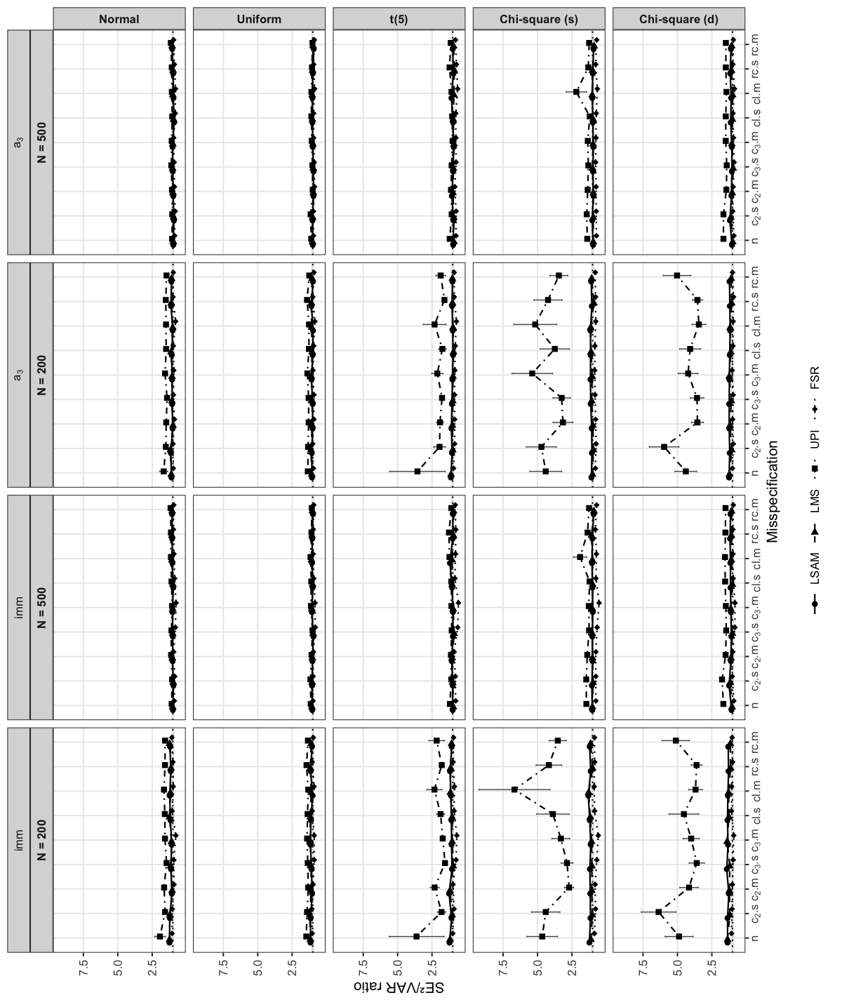
```

```{r}
#| label: fig-s-load
#| fig-cap: "Performance of the Cross-Loaded Mediator Indicator Loading ($m_3$) Across All Measures, Distributions, and (Mis)specifications at High Reliability, $N = 500$, and $a_3 = 0.2$"
#| out-width: "100%"
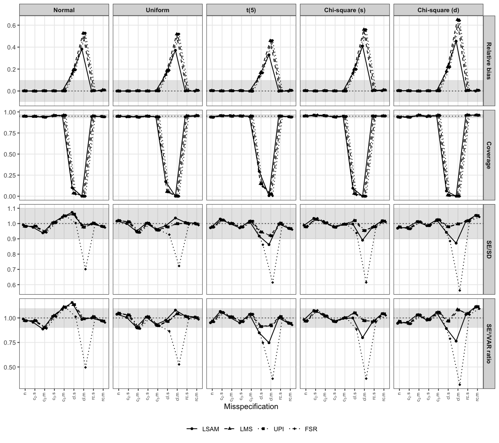
```
